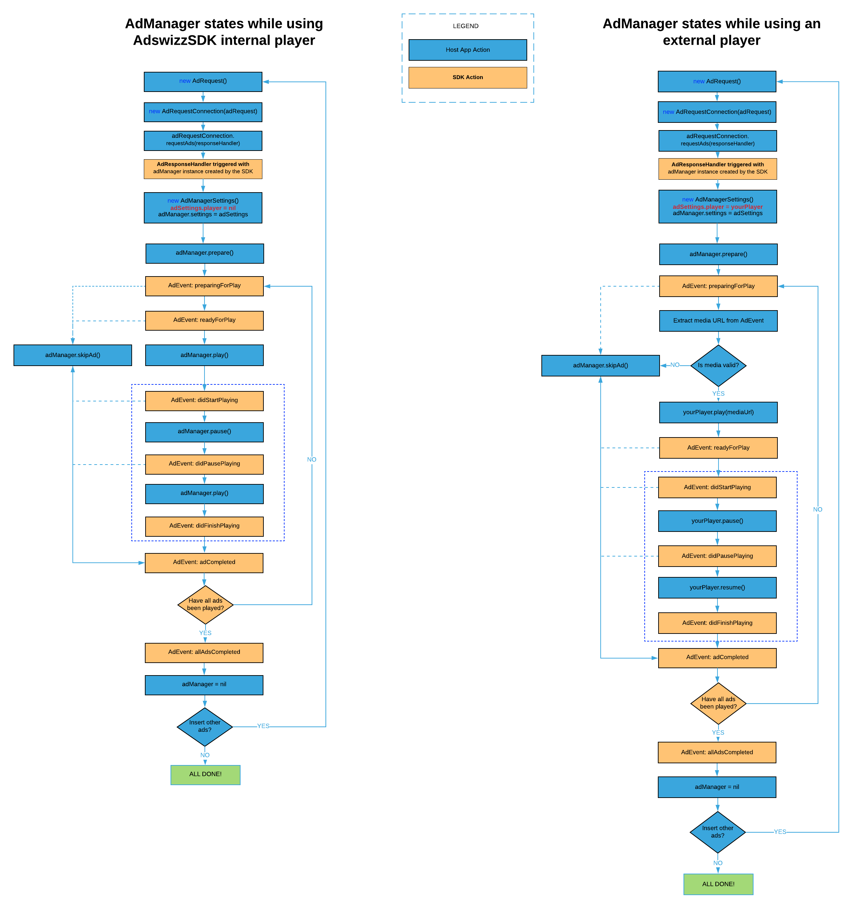

[](https://www.adswizz.com)
# **AdswizzSDK - Integration guide**
 * [<strong>Before you start</strong>](#before-you-start)
      * [What is ‘Client-Side Insertion’](#what-is-client-side-insertion)
      * [What is ‘Server-Side Insertion’](#what-is-server-side-insertion)
      * [Prerequisites for ‘Client-Side Insertion’](#prerequisites-for-client-side-insertion)
      * [Prerequisites for ‘Server-Side Insertion’](#prerequisites-for-server-side-insertion)
 * [<strong>Get started</strong>](#get-started)
      * [Prerequisites](#prerequisites)
      * [Changelog](#changelog)
      * [Dependencies](#dependencies)
      * [Permissions](#permissions)
         * [Disclaimer](#disclaimer)
      * [Package visibility](#package-visibility)
      * [Adding the SDK to your AndroidStudioProject project](#adding-the-sdk-to-your-android-studio-project)
      * [SDK initialization and cleanup](#sdk-initialization-and-cleanup)
      * [SDK initialization when installationId and playerId are unknown at compile time](#sdk-initialization-when-installationid-and-playerid-are-unknown-at-compile-time)
 * [<strong>Client-Side Insertion</strong>](#client-side-insertion)
      * [Your first ad request](#your-first-ad-request)
      * [Working with AdManager object](#working-with-admanager-object)
      * [AdManager operations](#admanager-operations)
      * [AdManager Interface](#admanager-interface)
         * [prepare](#prepare)
         * [play](#play)
         * [pause](#pause)
         * [skipAd](#skipad)
         * [reset](#reset)
         * [ads](#ads)
         * [analyticsCustomData](#analyticsCustomData)
      * [AdManagerListener interface](#admanagerlistener-interface)
      	 * [onEventReceived ](#oneventreceived)
		 * [onEventErrorReceived](#oneventerrorreceived)
      * [Handling AdManager with no ads](#handling-admanager-with-no-ads)
      * [(Advanced) Handling AdManager reporting for expected ads](#advanced-handling-admanager-reporting-for-expected-ads)
      * [AdManager life cycle](#admanager-life-cycle)
 * [<strong>Server-Side Insertion</strong>](#server-side-insertion)
      * [Your first stream manager](#your-first-stream-manager)
      * [AdStreamManager Listener interface](#adstreammanager-listener-interface)
      * [AdStreamManager life cycle](#adstreammanager-life-cycle)      
 * [<strong>Interactive ads</strong>](#interactive-ads)
      * [Shake enabled interactive ads](#shake-enabled-interactive-ads)
      * [Voice enabled interactive ads](#voice-enabled-interactive-ads)
      * [TapTap enabled interactive ads](#taptap-enabled-interactive-ads)
      * [Handling interactive ad events](#handling-interactive-ad-events)
 * [<strong>Companion Banner</strong>](#companion-banner)
      * [Adding an AdCompanionView](#adding-an-adcompanionview)
      * [Setting up](#setting-up)
      * [Server side & Podcasts setup](#server-side--podcasts-setup)
      * [Companion events](#companion-events)
      * [Extra exposure time](#extra-exposure-time)
      * [Preferred resource type](#preferred-resource-type)
 * [<strong>Video ads</strong>](#video-ads)
      * [Adding an AdVideoView](#adding-an-advideoview)
      * [Setup video support](#setup-video-support)
      * [Subclassing AdVideoView](#subclassing-advideoview)
      * [Video View Listener](#video-view-listener)
      * [Viewability](#viewability)
         * [Friendly obstructions](#friendly-obstructions)
         * [Video state](#video-state)
      * [Video View Cleanup](#video-view-cleanup)
 * [<strong>Podcasts</strong>](#podcasts)
      * [Getting started](#getting-started)
      * [Playback operations](#playback-operations)
        + [play](#play)
        + [pause](#pause)
        + [resume](#resume)
        + [stop](#stop)
        + [seekTo](#seekTo)
      * [Download operations](#download-operations)
        + [start download](#start-download)
        + [stop download](#stop-download)
        + [remove](#remove-download)
      * [AdPodcastManager.Listener interface](#adpodcastmanagerlistener-interface)
      * [AdPodcastManagerDownloadListener interface](#adpodcastmanagerdownloadlistener-interface)
      * [Remote Audio Data](#remote-audio-data)
      	+ [Handling RAD id3 metadata using your player](#handling-rad-id3-metadata-using-your-player)
 * [<strong>Playing ads using your player</strong>](#playing-ads-using-your-player)
      * [AdPlayer Interface](#adplayer-interface)
      * [CacheManager](#cache-manager)
 * [<strong>Integrate into Wear OS apps</strong>](#integrate-into-wear-os-apps)
      * [ShakeMe on Wear OS](#shakeme-on-wear-os)
      * [Voice Detector on Wear OS](#voice-detector-on-wear-os)
 * [<strong>AdswizzSDK general settings</strong>](#adswizzsdk-general-settings)
      * [GDPR consent](#gdpr-consent)
      * [CCPA config](#ccpa-config)
      * [Disable data collection](#disable-data-collection)
      * [XPAID header](#xpaid-header)
      * [Integrator Context](#integrator-context)
      * [Extra exposure time for an AdCompanionView](#extra-exposure-time-for-an-adcompanionview)
      * [Preferred resource type](#preferred-resource-type)
      * [Asset Quality](#asset-quality)
      * [preferredMaxBitrate](#preferredMaxBitrate)
      * [Enable RAD](#enable-rad)
 * [<strong>Open Measurement in AdswizzSDK</strong>](#open-measurement-in-adswizzsdk)
      * [Video controls obstructions](#video-controls-obstructions)
 * [<strong>(Optional) Prepare your application for advanced targetability capabilities</strong>](#optional-prepare-your-application-for-advanced-targetability-capabilities)
      * [Privacy implications](#privacy-implications)
 * [<strong>Vast Macros</strong>](#vast-macros)
 * [<strong>AdData interface</strong>](#addata-interface)
 * [<strong>Ad Base Manager adapters</strong>](#ad-base-manager-adapters)
 * [<strong>AdswizzSDK Analytics</strong>](#adswizzsdk-analytics)
      * [Customize AnalyticsEvent](#customize-analyticsevent)
          * [Custom analytics data through AdRequest](#custom-analytics-data-through-adrequest)
          * [Custom analytics data through Ad Manager](#custom-analytics-data-through-ad-manager)
 * [<strong>(Optional) Interoperability with PAL SDK</strong>](#optional-interoperability-with-pal-sdk)
   * [What you need to do](#what-you-need-to-do)
 * [<strong>AdswizzSDK for Fire OS</strong>](#adswizzsdk-for-fire-os)
 * [<strong>Sample projects</strong>](#sample-projects)
      * [BasicSample](#basicsample)
      * [StreamingSample](#streamingsample)
      * [StreamingSample with External Player](#streamingsample-with-external-player)
      * [DvrStreamingSample](#DvrStreamingSample)
      * [Precache Sample](#precache-sample)
      * [Video Ads Sample](#video-ads-sample)

# Before you start

This guide is addressed to the Android developers who want to integrate AdswizzSDK in their apps.

AdswizzSDK is not thread safe, so it is expected that all the calls to the SDK are done on the main thread. AdswizzSDK does all the heavy lifting on other threads, so that the main one remains responsive.

Here is a quick overview. More details will be provided for each scenario in their respective section.

## What is Client-Side Insertion

'Client-Side Insertion' represents the insertion of ads into the audio/video stream done by the integrator. Your app is responsible for the built-in logic to decide when to start and end an ad break by fetching ads from the ad server and playing them with your apps's audio/video capabilities. The SDK will handle all communication during ad fetching with the ad server while being in charge with the display of companion banner and performing various event reporting (impressions & quartiles).

## What is Server-Side Insertion

‘Server-Side Insertion’ represents the insertion of ads in the audio stream done by the server in real time. It requires AIS as a streaming server. AIS is the acronym for Audio Injector for Servers and is an AdsWizz product that does 'server-side insertion'.

The responsibilities are split between streaming server and SDK as follows:
* Streaming Server:
   * detects ad breaks and inserts audio ads into the audio stream
   * sends metadata information to make possible for the SDK to synchronize companion banner with the audio content and to detect interactive ads
* SDK:
   * decorates audio stream URL to increase targetability of ads
   * detects all events associated with an ad break (start, stop, change of ad)
   * retrieves, displays, synchronizes companion banner with audio content based on metadata information
   * may handle the display area for companion banners outside of an ad break
   * retrieves and processes interactivity information based on metadata

## Prerequisites for ‘Client-Side Insertion’

In order to successfully do the ‘Client-Side Insertion’ you will need to set/provide the following information for your **_AdswizzAdRequest_** object within **_AdRequestConnection_**:
*  adServer = the name of AdServer used to fetch ads from
*  zones = one or more ```AdswizzAdZone``` to identify the zone/zones used to retrieve audio/video ads from
*  companionZones = (optional) identifier of zone to retrieve creatives to be displayed by the companion banner
*  (optional) list of custom site variables used for ads selection (e.g referrer)

The following can be set as general AdswizzSDK parameters:
*  (optional) GDPR consent value
*  (optional) CCPA (U.S. privacy string) consent value
*  (optional) enable/disable data collection
*  (optional) integrator context. This contain information that the integrator should provide and will be used by the SDK (for example for VAST macro expansion)

For the client-side scenario, you may use any streaming server provided by your AdsWizz Integration Manager.

## Prerequisites for ‘Server-Side Insertion’

In order to successfully integrate the ‘Server-Side Insertion’, you will need to set the following information:
* in afrConfig:
   *  server = the name of Adserver used to insert ads from
   *  endpoint = contains the identifier of zone to retrieve creatives to be displayed by the companion banner
* in **_AdswizzAdStreamManager_**:
   *  adStreamURL = URL of audio stream. This is given in the play method.

The following can be set as general AdswizzSDK parameters:
*  (optional) GDPR consent value
*  (optional) CCPA (U.S. privacy string) consent value
*  (optional) enable/disable data collection
*  (optional) integrator context. This contain information that the integrator should provide and will be used by the SDK (for example for VAST macro expansion)


# Get started

AdswizzSDK facilitates the ad lifecycle management, right from your application.
Sensing listeners environment, it crafts the overall ad exercise for superior addressability and augmented interactivity.

On top, in a client-side insertion scenario, it retrieves the ad with its associated assets, and handles the reporting operations.<br>
In a server-side insertion scenario, it takes the pressure off your app by making the interactivity and assets easily available.


## Prerequisites

* AndroidStudio 3.4+
* Gradle build system

## Changelog

Please check [here](CHANGELOG.md) the latest AdswizzSDK version and all the new changes & fixes it comes with.

## Dependencies

 A list of external dependencies used in our phone and tablet SDK:

```groovy
kotlinStdlib = "org.jetbrains.kotlin:kotlin-stdlib-jdk7:${kotlin_version}"
kotlinReflect = "org.jetbrains.kotlin:kotlin-reflect:$kotlin_version"
appcompat = "androidx.appcompat:appcompat:${appcompatVersion}"
coreKtx = "androidx.core:core-ktx:${coreKtxVersion}"
exoPlayer = "com.google.android.exoplayer:exoplayer:$exoPlayerVerison"
gmsPlayServicesAds = "com.google.android.gms:play-services-ads:$gmsPlayServicesAdsVersion"
constraintLayout = "androidx.constraintlayout:constraintlayout:$constraintLayoutVersion"
lifeCycleExtensions = "androidx.lifecycle:lifecycle-extensions:$lifeCycleExtensionsVersion"
kotlinxCoroutines= "org.jetbrains.kotlinx:kotlinx-coroutines-core:$kotlinxCoroutinesVersion"
kotlinxCoroutinesAndroid = "org.jetbrains.kotlinx:kotlinx-coroutines-android:$kotlinxCoroutinesVersion"
moshi = "com.squareup.moshi:moshi:$moshiVersion"
moshiAdapters = "com.squareup.moshi:moshi-adapters:$moshiVersion"
moshiCodeGen = "com.squareup.moshi:moshi-kotlin-codegen:$moshiVersion"
protobufJavaLite = "com.google.protobuf:protobuf-javalite:$protobufJavaLiteVersion"
playServicesWearable = "com.google.android.gms:play-services-wearable:$playServicesWearableVersion"
lifecycleRuntimeKtx = "androidx.lifecycle:lifecycle-runtime-ktx:$lifecycleRuntimeKtxVersion"
androidMaterial = "com.google.android.material:material:$androidMaterialVersion"
commonsMath3 = "org.apache.commons:commons-math3:$commonsMath3Version"
gmsPlayServicesLocation = "com.google.android.gms:play-services-location:$gmsPlayServicesLocationVersion"
awsAndroidSdkCore = "com.amazonaws:aws-android-sdk-core:$awsAndroidSdkCoreVersion"
workManagerRuntime = "androidx.work:work-runtime-ktx:$workManagerRuntimeVersion"
```

For our Wear OS SDK we use:

```groovy
kotlinStdlib = "org.jetbrains.kotlin:kotlin-stdlib-jdk7:${kotlin_version}"
androidXWear = "androidx.wear:wear:$androidXWearVersion"
supportWearable = "com.google.android.support:wearable:$wearableSupportVersion"
googleWearable = "com.google.android.wearable:wearable:$googleWearableVersion"
playServicesWearable = "com.google.android.gms:play-services-wearable:$playServicesWearableVersion"
kotlinxCoroutines= "org.jetbrains.kotlinx:kotlinx-coroutines-core:$kotlinxCoroutinesVersion"
kotlinxCoroutinesAndroid = "org.jetbrains.kotlinx:kotlinx-coroutines-android:$kotlinxCoroutinesVersion"
lifecycleRuntimeKtx = "androidx.lifecycle:lifecycle-runtime-ktx:$lifecycleRuntimeKtxVersion"
commonsMath3 = "org.apache.commons:commons-math3:$commonsMath3Version"
```

We have tested the above dependencies using the following version numbers:<br>

```groovy
//Library
appcompatVersion = '1.1.0'
coreKtxVersion = '1.1.0'
exoPlayerVerison = '2.10.0' // and '2.11.3' too
gmsPlayServicesAdsVersion = '18.2.0'
moshiVersion = '1.8.0'
androidMaterialVersion = "1.0.0"
constraintLayoutVersion = "1.1.3"
lifeCycleExtensionsVersion = "2.1.0"
kotlinxCoroutinesVersion = "1.3.2"
workManagerRuntimeVersion = "2.4.0"
protobufJavaLiteVersion = '3.11.0'

//WearOS
wearableSupportVersion = '2.5.0'
playServicesWearableVersion = '17.0.0'
percentLayoutVersion = '1.0.0'
legacySupportVersion = '1.0.0'
recyclerViewVersion = '1.1.0'
lifecycleRuntimeKtxVersion = '2.2.0'
androidXWearVersion = '1.0.0'
googleWearableVersion = '2.5.0'
```

---
**NOTE**

If you are excluding any tested dependency version and use another version instead of it (that doesn't ensure backward/forward compatibility with the version we have tested) you may encounter unexpected behaviour.

---  

## Permissions

With the addition of the SDK to your project, there will be only a couple of permissions that will appear in your merged manifest file. These are the bare minimum in order for the sdk to function.

The AdswizzSDK uses the following permissions:

```xml
<manifest>
....
    <uses-permission android:name="android.permission.INTERNET" />
    <uses-permission android:name="android.permission.VIBRATE" />
....
</manifest>
```

AdswizzWearSDK uses the following permissions:

```xml
<manifest>
....
<uses-permission android:name="android.permission.FOREGROUND_SERVICE" />
<uses-permission android:name="android.permission.INTERNET" />
<uses-permission android:name="android.permission.VIBRATE" />
....
</manifest>
```

In order to take full advantage of everything that the SDK has to offer additional permissions will be needed.

The AdswizzSDK additional permissions are:

```xml
<manifest>
....
    <!-- used in sonar tracking endpoint for the gps location. Used in analytics when sending the batch to the server -->
    <uses-permission android:name="android.permission.ACCESS_FINE_LOCATION" />
    <!-- used for polling and profile sonar endpoints to get the microphone status. Used for speech recognition during voice ads -->
    <uses-permission android:name="android.permission.RECORD_AUDIO" />
    <!-- used in interactivity for the download file and download pass file actions -->
    <uses-permission android:name="android.permission.WRITE_EXTERNAL_STORAGE" />
    <!-- used in interactivity call action -->
    <uses-permission android:name="android.permission.CALL_PHONE" />
    <!-- used during creative selection based on network conditions. Used in interactivity call action -->
    <uses-permission android:name="android.permission.READ_PHONE_STATE" />
    <!-- used during creative selection based on network conditions -->
    <uses-permission android:name="android.permission.ACCESS_NETWORK_STATE" />
    <!-- used for sonar profile and polling endpoints when it populates the wifi info -->
    <uses-permission android:name="android.permission.ACCESS_WIFI_STATE"/>
    <!-- used in sonar tracking endpoint for the gps location -->
    <uses-permission android:name="android.permission.ACCESS_COARSE_LOCATION" />
    <!-- used for profile and polling sonar endpoints -->
    <uses-permission android:name="android.permission.BLUETOOTH" />
    <!-- we use it in sonar to add the list of installed apps and bundleVersion to the profile endpoint -->
    <uses-permission android:name="android.permission.QUERY_ALL_PACKAGES" />

    <!-- used for sonar polling endpoint where it sends the list of user activities -->
    <!-- Required for 28 and below. -->
    <uses-permission android:name="com.google.android.gms.permission.ACTIVITY_RECOGNITION" />
    <!-- Required for 29+. -->
    <uses-permission android:name="android.permission.ACTIVITY_RECOGNITION" />
....
</manifest>
```

For AdswizzWearSDK there is only one additional permission:

```xml
<manifest>
....
    <!-- Used for speech recognition during voice ads -->
    <uses-permission android:name="android.permission.RECORD_AUDIO" />
....
</manifest>
```

These additional permissions will have to be manually added in the host app manifest. Keep in mind that for missing permissions, some of the features from our SDK might not work. We handle the case of permissions missing so you don't have to worry about crashes.

If you want to keep some permissions only for the host app to use then the following function `AdswizzSDK.setPermissionStatus` will help with denying the unwanted permission to the Adswizz SDK. By default the Adswizz SDK will use all permissions that the host app will use. If you need to know if a permission is allowed to be used by the Adswizz SDK then you can call `AdswizzSDK.getPermissionStatus`.

### Disclaimer
- Please be advised that including AdsWizz SDK in your project might require your application to ask for specific permissions, in order to take full advantage of the special formats and/or enhance targeting capabilities.
- A complete list with all the permissions we require and why may be found here: https://support.adswizz.com/hc/en-us/articles/360018903057
- We highly encourage you to loop your product and legal teams in the process of agreeing which features to enable, and finding the best way to reflect this in your application’s Privacy Policy.


## Package visibility

Android 11 changes how apps can query and interact with other apps that the user has installed on a device. Using the <queries> element, apps can define the set of other packages that they can access. This element helps encourage the principle of least privilege by telling the system which other packages to make visible to your app, and it helps app stores like Google Play assess the privacy and security that your app provides for users.

The AdswizzAdSDK uses the following queries setup:

```xml
<manifest>
....
    <queries>
        <intent>
            <action android:name="android.speech.RecognitionService" />
        </intent>
        <intent>
            <action android:name="android.intent.action.VIEW" />
            <data android:mimeType="*/*" />
        </intent>
        <intent>
            <action android:name="android.intent.action.INSERT" />
        </intent>
        <intent>
            <action android:name="android.intent.action.DIAL" />
        </intent>
        <intent>
            <action android:name="android.intent.action.SENDTO" />
        </intent>

        <package android:name="com.google.android.apps.maps" />
        <package android:name="com.here.app.maps" />
        <package android:name="com.waze" />
        <package android:name="net.osmand" />
        <package android:name="com.sygic.aura" />
        <package android:name="com.nng.igo.primong.igoworld" />

        <package android:name="android.settings.APPLICATION_DETAILS_SETTINGS" />

    </queries>
....
</manifest>
```

AdswizzWearSDK uses the following queries setup:

```xml
<manifest>
....
    <queries>
        <intent>
            <action android:name="android.speech.RecognitionService" />
        </intent>
    </queries>
....
</manifest>
```

If you want to change these queries in your app you can use the following line of code to remove it. Afterwards you will have to write your own <queries>.

```xml
<queries tools:node="remove" />
```

Please note that if you remove the queries, some of the features from our SDK might not work. The system manages these automatically so you don't have to worry about crashes.

## Adding the SDK to your Android Studio Project

You can easily integrate AdswizzSDK into your project. There are 2 steps to this integration:

1. Inside your project level build.gradle add the following block inside the allprojects->repositories tag:

```groovy
maven {
    url "https://raw.githubusercontent.com/adswizz/ad-sdk-android/master/releases"
        credentials(HttpHeaderCredentials) {
            name = "Authorization"
            value = "Bearer YOUR-AUTH-TOKEN-PROVIDED-BY-ADSWIZZ-PIM"
        }
    authentication {
        header(HttpHeaderAuthentication)
    }
}
```

The final code should look something like this:

```groovy
allprojects {
    repositories {
        google()
        jcenter()
        maven {
            url "https://raw.githubusercontent.com/adswizz/ad-sdk-android/master/releases"
            credentials(HttpHeaderCredentials) {
                name = "Authorization"
                value = "Bearer YOUR-AUTH-TOKEN-PROVIDED-BY-ADSWIZZ-PIM"
            }
            authentication {
                header(HttpHeaderAuthentication)
            }
        }
    }
}
```

2. Then, inside your module level build.gradle add the following line inside the dependencies block:

```groovy
implementation 'com.adswizz:adswizz-sdk:version'
implementation 'com.adswizz:exoplayer2-10:version'
```

_Note_: the sdk before 7.6.1 included the exoplayer dependency. now this dependency is separated and you must include it to function correctly. at this time (SDK 7.7.13) there 5 exoplayer artifacts available, based on the included exoplayer version (2.10, 2.12, 2.14, 2.15, 2.16)

Where <strong>version</strong> is the latest version of the phone and tablet SDK provided by AdsWizz (i.e. 7.7.2 - the latest version). Please notice the below example:

```groovy
implementation 'com.adswizz:adswizz-sdk:7.7.2'
implementation 'com.adswizz:exoplayer2-10:7.7.2'
```

_Note_: This artifact is using __protobuf java lite__ internally. In case your application is using the full protobuf java library you'll have to use another sdk artifact as following:

```groovy
implementation 'com.adswizz:adswizz-sdk-protobufJava:7.7.2'
```

Note:
if you are compiling with an API > 30 (*Android 11*) you must also include a newer version of Androidx WorkManager runtime as follows:

```groovy
implementation 'androidx.work:work-runtime-ktx:2.7.1'
implementation 'androidx.work:work-multiprocess:2.7.1'
```
This is necessary since the included WorkManager version in the SDK doesn't implement the PendingIntent _*FLAG_IMMUTABLE*_ requirements introduced in Android 12
    
(optional) 3. The Adswizz Android SDK is using Google Play Services (`com.google.android.gms.ads.identifier.AdvertisingIdClient`) in order to get the Google Advertising ID (GAD). In order to do this your application may need to have following meta added in your `AndroidManifest.xml` file.
```xml
<meta-data
    android:name="com.google.android.gms.ads.AD_MANAGER_APP"
    android:value="true" />
```

The above meta should be placed inside of the `application` tag like in the below example:
 ```xml
<application
    android:allowBackup="true"
    android:icon="@mipmap/ic_launcher"
    ...
    <meta-data
        android:name="com.google.android.gms.ads.AD_MANAGER_APP"
        android:value="true" />
    ...
</application>
 ```

Note: If the above `meta` is not added in your `AndroidManifest.xml` file you may receive an error message in Logcat like this one `"The Google Mobile Ads SDK was initialized incorrectly."` and your application will crash during the initialization.


## SDK initialization and cleanup

First, you need to add the installationId, provided by an AdsWizz engineer or PIM, to your manifest. It should look like this:

```xml
<application
    android:name="path.to.myApp.MyApp"
    android:allowBackup="true"
    android:icon="@mipmap/ic_launcher"
    android:label="@string/app_name"
    android:roundIcon="@mipmap/ic_launcher_round"
    android:supportsRtl="true"
    android:theme="@style/AppTheme">
    ....
    <meta-data android:name="com.adswizz.core.installationId" android:value="ADD_YOUR_INSTALLATION_ID_HERE" />
    ....
</application>
```

Second, you need to add the playerId to your manifest. This is also obtained from an AdsWizz engineer or PIM. It should look like this:

```xml
<application
    android:name="path.to.myApp.MyApp"
    android:allowBackup="true"
    android:icon="@mipmap/ic_launcher"
    android:label="@string/app_name"
    android:roundIcon="@mipmap/ic_launcher_round"
    android:supportsRtl="true"
    android:theme="@style/AppTheme">
    ....
    <meta-data android:name="com.adswizz.core.installationId" android:value="ADD_YOUR_INSTALLATION_ID_HERE" />
    <meta-data android:name="com.adswizz.core.playerId" android:value="ADD_YOUR_PLAYER_ID_HERE" />
    ....
</application>
```

If adding the installation id and player id at compile time is not an option then read [SDK initialization when installationId and playerId are unknown at compile time](#sdk-initialization-when-installationid-and-playerid-are-unknown-at-compile-time).

Next, you need to initialize the AdswizzSDK. The recommended way to do this is in the onCreate of your application. If you already extended
the application class just add the following line inside the onCreate method:

```kotlin
AdswizzSDK.initialize(this)
```

If you didn't already extend the Application class you can do it now. It should look something like this:

```kotlin
class MyApp : Application() {

    override fun onCreate() {
        super.onCreate()
        AdswizzSDK.initialize(this)
    }
}
```

Don't forget to add this new class in your manifest. It should look like this:

```xml
<application
    android:name="path.to.myApp.MyApp"
    android:allowBackup="true"
    android:icon="@mipmap/ic_launcher"
    android:label="@string/app_name"
    android:roundIcon="@mipmap/ic_launcher_round"
    android:supportsRtl="true"
    android:theme="@style/AppTheme">
    ....
</application>
```

For cleanup you should use:

```kotlin
AdswizzSDK.cleanup()
```

Call it when you will no longer need the SDK.

## SDK initialization when installationId and playerId are unknown at compile time

If the installationId or playerId are not known at compile time and you want to set them at runtime you can construct an `AdswizzSDKConfig` data class and pass it to `AdswizzSDK.initialize` method. See below:

```kotlin
val installationId = ...
val playerId = ...
AdswizzSDK.initialize(context, AdswizzSDKConfig(installationId, playerId))
```


# Client-Side Insertion

## Your first ad request

You are now ready for your first ad request. You will need to create an AdswizzAdRequest object and configure it.

**Minimal request parameters**
The `AdswizzAdRequest` requires at minimum to set server url and a set of one ore more `AdswizzAdZone`.

```kotlin
	data class AdswizzAdZone @JvmOverloads constructor(
        @Json(name = "zoneId")
        val zoneId: String,
        @Json(name = "maxAds")
        val maxAds: Int? = null,
        @Json(name = "maxDuration")
        val maxDuration: Long? = null
)
```
Each `AdswizzAdZone` object is defined by a mandatory zoneId and optionals maxAds and maxDuration fields, where zoneId is provided by PIM and the other fields are defined by the application logic therefore not mandatory.


The minimal request than looks like the following: one or more zones and a server url 
```kotlin
val adRequest: AdswizzAdRequest = AdswizzAdRequest.Builder() //Build the Ad Request with the needed parameters
            .withServer("SERVER_PROVIDED_BY_PIM")
            .withZones(setOf(AdswizzAdZone("ZONEID_1_PROVIDED_BY_PIM"), ... AdswizzAdZone("ZONEID_n_PROVIDED_BY_PIM")))
            .build()
```
The ad server and the zoneId(s) will be provided to you by an AdsWizz PIM.

**Custom request parameters**

You may use custom parameters (key-value pairs) in your requests, in order to send various information, such as the TCF v2 consent string, the publisher-specific ID, first-party targeting data etc.
Here is an example:

```kotlin
	AdswizzAdRequest.Builder()
		.withCustomParameter("key1=URLEncodedValue1&key2=URLEncodedValue2")
		...
```

**Duration request parameters**

An optional parameter is duration which sets the maximum total duration of ads to be selected, in seconds. It can be used to fine tune the ad(s) delivery and request a specific total duration.
Duration parameter is set in milliseconds
Here is an example that sets max duration to 90 seconds

```kotlin
	AdswizzAdRequest.Builder()
		...	
		.withDuration(90000L)
		...
```

**(Advanced) Enable expected ads reporting**

You may enable the reporting on the number of expected ads by setting the `enableExpectedAdsReporting` to `true` in your **_AdswizzAdRequest_** objects. By default `enableExpectedAdsReporting` is `false`.

Here is an example:
```kotlin
    AdswizzAdRequest.Builder()
        ...
        .withExpectedAdsReporting(true)
        ...
```

Read more about this behaviour at [(Advanced) Handling AdManager reporting for expected ads](#advanced-handling-admanager-reporting-for-expected-ads).

**AdRequestConnection**

After this point you need to create an AdRequestConnection object and call requestAds with the ad request object.

```kotlin            
val adRequestConnection = AdRequestConnection(adRequest) // Create the AdRequestConnection using the above adRequest

adRequestConnection.requestAds { adManager, error ->
            // Handle the response from server
            handleResponse(error, adManager)
        }
```
As a result, of this call the SDK will provide you with an error if the call was a failure or an AdManager object if the result was a success.

## Working with AdManager object

If the request to the AdsWizz Ad server was a success, the SDK will return an AdManager object which you will own and will be the way the SDK will communicate events back to your application.
To get this communication channel open, you need to set up a listener for the AdManager that conforms to the AdManagerListener interface. The AdManager will call:

`onEventReceived(adManager: AdManager, event: AdEvent)` whenever events of interest might happen in the SDK. Consult AdEvent.Type for a list of possible events from the AdswizzSDK.

If an error happens in the SDK while using this object, `onEventErrorReceived(adManager: AdManager, ad: AdData?, error: Error)` will be called.

As a first step, an **_AdManager_** needs to have some settings. You can create an **_AdManagerSettings_** object and pass it to your newly created instance of **_AdManager_**. Otherwise the **_AdMnager_** will use the default values.  
In this object you can specify if you want to play the ad with the SDK’s internal player or a player of your choice that must conform to **_AdPlayer_** interface.  
Also you can specify the cache policy (default none), the assets quality preference (default high), the video view id and if the player should play the ads one by one or as a playlist (enqueueEnabled, default true).

Next, you need to call prepare method on the **_AdManager_** object.
This will buffer the ads if you decide to play them with the internal player. Here is how it looks like.

```kotlin
class MainActivity : AppCompatActivity(), AdManagerListener {

    override fun onCreate(savedInstanceState: Bundle?) {
        super.onCreate(savedInstanceState)
        setContentView(R.layout.activity_main)

        val adRequest: AdswizzAdRequest =
            AdswizzAdRequest.Builder() //Build the Ad Request with the needed parameters
                .withServer("SERVER_PROVIDED_BY_PIM")
                .withZones(setOf(AdswizzAdZone("ZONEID_PROVIDED_BY_PIM")))
                .build()

        val adRequestConnection =
            AdRequestConnection(adRequest) // Create the AdRequestConnection using the above adRequest

        adRequestConnection.requestAds { adManager, error ->
            // Handle the response from server
            if (adManager != null) {
                //Handle success
                adManager.adManagerSettings = AdManagerSettings.Builder() // optional
                    .adPlayerInstance(YOUR_AD_PLAYER_GOES_HERE) // optional
                    .addCachePolicy(CachePolicy.ASSETS)         // optional
                    .assetQuality(AssetQuality.MEDIUM)          // optional, other possible values AssetQuality.LOW, AssetQuality.HIGH, AssetQuality.AUTO
                    .enqueueEnabled(false)                      // optional
                    .videoViewId(1)                             // optional
                    .build()                                    // optional
                adManager.setListener(this) // Get notifications from the Ad SDK
                adManager.prepare() // Start buffering the ads in the AdManager
                adManager.play() // Start playing when first add finish loading
            } else {
                //Handle failure
                Log.e("Error", error.toString())
            }
        }
    }

    override fun onEventErrorReceived(adManager: AdManager, ad: AdData?, error: Error) {
    }

    override fun onEventReceived(adManager: AdManager, event: AdEvent) {
        when(event.type) {
            AdEvent.Type.State.ReadyForPlay ->  {
                // An add has finished loading and is ready for play
            }
            AdEvent.Type.State.DidFinishPlaying -> {
                // Current ad has finished playing
            }
            AdEvent.Type.State.AllAdsCompleted -> {
                // All ads from the AdManager have finished
            }

            else  -> {
                //do nothing
                //If you want to handle other events individually you can use the same syntax as above,
                //just specify the event type
            }
        }
    }
}
```
To actually start the **_AdManager_** rolling the ads you must call the play method on the **_AdManager_** as we did in the example above.

## AdManager operations

Once presented with an AdManager, one could call different actions on the AdManager. Let’s break them down.

## AdManager interface
### prepare

You call this method to begin to cycle through the ads in the AdManager. This method ensures that the player is starting to buffer enough data so that ad playing starts smoothly. Upon calling this method the ads start loading. The SDK will trigger **_PreparingForPlay_** event informing your app that buffering has begun for a specific ad. Once buffering is done, **_ReadyForPlay_** event for the ad will be triggered. In case the `adManager` instance has no ad (EmptyAds scenario), a **_ReadyForPlay_** event with `null` instead of an `AdEvent` instance will be triggered.

### play

Call **_play_** when you want to play the ads. This can be done before or after the callback **_ReadyForPlay_** was triggered. The SDK will respond with the callback **_DidStartPlaying_** when the playback begins. If the playing was pause use **_resume_** function instead, to resume playing.


### pause

The **_pause_** method will stop playing the ads in the AdManager. AdManager will trigger a **_DidPausePlaying_** event back to your app for confirmation.


### resume

Call **_resume_** when you want to play the ads after a pause. The SDK will trigger a **_DidResumePlaying_** event back to your app for confirmation.


### skipAd

If you need to skip an ad you can call this method to skip the current ad from the AdManager. Your app will receive
a **_DidSkip_** or **_NotUsed_** event for the current ad and it will start to play the next one. If no ads are available, an **_AllAdsCompleted_** will be sent,
signalling that all ads got processed in the AdManager.


### reset

If you decide to skip all ads in the AdManager from the current one you can call this method. For the current ad skipped
your app will trigger **_DidSkip_** or **_NotUsed_** and for the rest **_NotUsed_**. A **_AllAdsCompleted_** event will be sent at the end.
Looping through the ad again will need a call to **_prepare_** function.</br>

### ads

Get the normal ads in the ad manager. A zero value means the Ad Manager will not play any ad.

### analyticsCustomData

Set an **_AnalyticsCustomData_** data class to provide key-value custom attributes to all **_AnalyticsEvent_** instances triggered by the AdswizzSDK for Analytics purposes. Read more at [AdswizzSDK Analytics](#adswizzsdk-analytics).


## AdManagerListener interface

Notifications sent from `AdManager` to your app are implemented in the AdManagerListener interface. After listener is set using `setListener(listener: AdBaseManagerListener)` method of the AdManager your app will be called for the following cases

### onEventReceived 

Called when there is an event with the current ad in the ad manager. Some of the events are: Initialized, FirstAdWillInitialize, PreparingForPlay, ReadyForPlay, DidStartPlaying, DidResumePlaying, DidFinishPlaying , Completed and so on. See `AdEvent` for a complete list. 

### onEventErrorReceived

Called when there was an error playing the ad.


## Handling AdManager with no ads

In some cases the **_AdManager_** you'll receive won't have any playable ads. In this case inspecting the `ads` property on the **_AdManager_** will return a zero count. Read more about this property in the above section.
A non playable ad is referred to as being an _empty ad_. The empty ads won't play any media, however your app still needs to instruct the **_AdManager_** to play them by calling the `play()` method.

Nevertheless, here is a simplified setup that highlights handling an **_AdManager_** with no ads:

```kotlin
......

override fun onEventReceived(adManager: AdManager, event: AdEvent) {
    when (event.type) {
         .....
        AdEvent.Type.State.ReadyForPlay -> {
            appLogs.addEntry("Ad ${event.ad?.id} - ready for play")
            
            //Start playing the next ad in the AdManager. 
            //Notice that there is no need to check if the ad is empty or not.
            //The SDK will handle it internally and send the appropriate AdEvent just like for a non empty ad.
            adManager?.play()
            
            //Note: just to be sure that the ad playback will start immediately wait for the <<AdEvent.Type.State.ReadyForPlay>> event before calling adManager?.play()
        }
        .....
        AdEvent.Type.State.AllAdsCompleted -> {
            appLogs.addEntry("Ad - all ads completed")
            
            //All ads from the AdManager have finished.
            //Here you can resume playing your content.
        }
    }
}
......
}
```
Important: failing to call `play()` on an **_AdManager_** with no ads it will prevent AdswizzSDK to correctly track and fire opportunities for reporting purposes.

## (Advanced) Handling AdManager reporting for expected ads

Before requesting ads from the Adswizz server in a [Client-Side Insertion](#client-side-insertion) scenario, on the **_AdswizzAdRequest_** object you can enable **_AdManager_** reporting for the number of expected ads by setting the `enableExpectedAdsReporting` property to `true`. See [Your first ad request](#your-first-ad-request).

When setting the `maxAds` value for an **_AdswizzAdZone_**, the Adswizz server will try to respond with that number of ads.
However, when it cannot fulfill that request, by setting the `enableExpectedAdsReporting` to `true`, the SDK will calculate the difference between number of expected ads (totalMaxAds) and the number of ads from the response and it will determine how many _empty ads_ there are:
```kotlin
numberOfEmptyAds = totalMaxAds - numberOfAdsFromVASTResponse
```

Note that the `totalMaxAds` also takes into account zones which didn't configure a specific `maxAds` in which case every such zone will count as +1 towards the total number of expected ads.

Read more about _empty ads_ at [Handling AdManager with no ads](#handling-admanager-with-no-ads).

The `numberOfEmptyAds` computed above represents the number of _empty_ ads that will be appended to the ads container of the resulting **_AdManager_**.
For each _empty_ **_AdData_** the SDK will fire the `urlsForNoAd(adBaseManager: AdBaseManager, noAdUrlString: String): List<String>`
callback of the `AdBaseManagerAdapter` interface.

Read more about `AdManagerDatasource` methods and behaviour at [Working with AdManager object](#working-with-admanager-object).

**Example**
```kotlin
        ...
        val adRequest: AdswizzAdRequest =
            AdswizzAdRequest.Builder() //Build the Ad Request with the needed parameters
                .withServer("SERVER_PROVIDED_BY_PIM")
                .withExpectedAdsReporting(true)
                .withZones(setOf(AdswizzAdZone(zoneId = "12345", maxAds = 3), AdswizzAdZone(zoneId = "122245", maxAds = 2), AdswizzAdZone(zoneId = "17865")))
                .build()
        ....
```
In the above request the number of ads requested are 3 (zoneId = "12345") + 2 (zoneId = "122245") + 1 (zoneId = "17865") = 6. If no maxAds is provided (like for zone "17865")
or is equal to 0, this actually means that 1 ad is requested. In this example the `numberOfEmptyAds` are `6 - numberOfAdsFromVASTResponse`.


## AdManager life cycle

After requesting your first ad from the Adswizz ad server, you are ready to play the ads from the AdManager object. Keep in mind that you might receive more than one ad from the server, but you are not required to play them all. If you decide to play multiple ads in your app, you need to listen to the events that the AdManager sends to your app and decide what is the appropriate action to take. Here is a diagram of the AdManager state.




# Server-Side Insertion


## Your first stream manager


AdswizzSDK handles interactive ad insertions, while playing HLS or ICY live streams from Ad Insertion Servers. This is possible by reading the player's metadata for specific Adswizz data and convert it in Adswizz interactive formats or companion banners.

To get started, you need to create an **_AdswizzAdStreamManager_** object with a URL pointing to the ad server your Integration Manager provided you with.


```kotlin

import com.adswizz.core.streaming.AdswizzAdStreamManager

class YourClass {

    private var streamManager: AdswizzAdStreamManager? = null

    fun createStreamManager() {
        streamManager = AdswizzAdStreamManager(null)
    }
}

```

Once the stream manager is constructed it is recommended to set a listener:

```kotlin
class YourClass {

    private var streamManager: AdswizzAdStreamManager? = null

    private val listener = object : AdStreamManager.Listener {
        override fun willStartPlayingUrl(adStreamManager: AdStreamManager, url: Uri) {
            println("Will start playing url: $url")
        }

        override fun didFinishPlayingUrl(adStreamManager: AdStreamManager, url: Uri) {
            println("Did finish playing url: $url")
        }

        override fun didPausePlayingUrl(adStreamManager: AdStreamManager, url: Uri) {
            println("Did paused playing url: $url")
        }

        override fun didResumePlayingUrl(adStreamManager: AdStreamManager, url: Uri) {
            println("Did resume playing url: $url")
        }

        override fun adBreakStarted(adStreamManager: AdStreamManager, adBaseManager: AdBaseManager) {
            println("Ad break started: adBaseManager $adBaseManager")
        }

        override fun adBreakEnded(adStreamManager: AdStreamManager, adBaseManager: AdBaseManager) {
            println("Ad break ended: adBaseManager $adBaseManager")
        }

        override fun onError(adStreamManager: AdStreamManager, error: Error) {
            println("Error - ${error.message} for adStreamManager: $adStreamManager")
        }

        override fun onMetadataChanged(adStreamManager: AdStreamManager, metadataItem: AdPlayer.MetadataItem) {
            println("Metadata received - adStreamManager: $adStreamManager - metadata count: ${metadataItem.value.count()}")
        }

        override fun onDvrMetadataReceived(adStreamManager: AdStreamManager, dvrBufferInfo: DvrBufferInfo?) {
            println("DVR Metadata received - adStreamManager: $adStreamManager - hasDVRenabled=${dvrBufferInfo != null}")
        }
    }

    fun createStreamManager() {
        streamManager = AdswizzAdStreamManager(null)
        streamManager?.addListener(listener)
    }
}

```

The stream object can play the url using his internal player or using an external player provided by you. This should be specified in the **_AdManagerStreamingSettings_**. Also the enqueueEnabled feature can be set in this class. Below is a sample on how to set the external player:


```kotlin
    fun createStreamManager() {
        val settings = AdManagerStreamingSettings.Builder()
            .adPlayerInstance(externalPlayer)
            .enqueueEnabled(false)                  // optional
            .build()
        streamManager = AdswizzAdStreamManager(settings)
        ...
    }
```

To start playing the stream do the following:

```kotlin
    streamManager?.play(AIS_STREAM_URL)
```

As a response, **_AdswizzSDK_** will call back `fun willStartPlayingUrl(adStreamManager: AdStreamManager, url: Uri)` with the provided url that has some extra query params added.

To stop the playing of stream call the stop function:

```kotlin
    streamManager?.stop()
```

The SDK will respond with the callback `fun didFinishPlayingUrl(adStreamManager: AdStreamManager, url: Uri)`. The url is the same as for `willStartPlayingUrl`.

The stream can be paused and resumed:

```kotlin
    //...
    streamManager?.pause()
    //...
    streamManager?.resume()
    //...
```

The SDK will respond with the callbacks `fun didPausePlayingUrl(adStreamManager: AdStreamManager, url: Uri)` and `fun didResumePlayingUrl(adStreamManager: AdStreamManager, url: Uri)` respectively. The url is the same as for `willStartPlayingUrl`.

## DVR Timeshifting capability

The SDK offers DVR timeshifting capability on HLS streams provided by AIS that have this feature enabled. To enable this feature on SDK side you have to specify this in the **_AdManagerStreamingSettings_** as follows:

```kotlin
    fun createStreamManager() {
        val settings = AdManagerStreamingSettings.Builder()
            .adPlayerInstance(externalPlayer)
            .dvrEnabled(true)
            .build()
        streamManager = AdswizzAdStreamManager(settings)
        ...
    }
```

 Please note that enabling DVR in Stream Manager's settings will automatically disable enqueue capability to ensure the functionality works as intended.

After enabling DVR start with normal play first

```kotlin
    streamManager?.play(AIS_STREAM_URL)
```

After the stream starts playing, if the stream server supports and has enabled the DVR feature for that particular stream it will provide more information through the **_AdStreamManager.Listener_** by calling

```kotlin
fun onDvrMetadataReceived(adStreamManager: AdStreamManager, dvrBufferInfo: DvrBufferInfo?)
```

When you get this callback called with a non-null **dvrBufferInfo** you know that you can now perform timeshift by using

```kotlin
    streamManager?.play(AIS_STREAM_URL, timestamp)
```

Do note that the timestamp is in epoch milliseconds format (milliseconds elapsed from 1st of January 1970) and it should be a value between **dvrBufferInfo.start** and **dvrBufferInfo.latest**.

The fields of the **DvrBufferInfo** are:

* start - represents the earliest moment that can be accessed with a timeshift play action (epoch milliseconds timestamp)
* latest - represents the latest moment that can be accessed (it differs from now because the server works with the stream in chunks) (epoch milliseconds timestamp)
* maxBufferSize - represents the largest buffer the server is capable to store (milliseconds value) and this gives the largest window the client can timeshift in the past. eg 36.000.000ms -> 10h window

## AdStreamManager Listener interface

The available callbacks that are called by the stream manager are described below:

```kotlin
    interface Listener {
        fun willStartPlayingUrl(adStreamManager: AdStreamManager, url: Uri)
        fun didFinishPlayingUrl(adStreamManager: AdStreamManager, url: Uri)
        fun didPausePlayingUrl(adStreamManager: AdStreamManager, url: Uri)
        fun didResumePlayingUrl(adStreamManager: AdStreamManager, url: Uri)
        fun adBreakStarted(adStreamManager: AdStreamManager, adBaseManager: AdBaseManager)
        fun adBreakEnded(adStreamManager: AdStreamManager, adBaseManager: AdBaseManager)
        fun onMetadataChanged(adStreamManager: AdStreamManager, metadataItem: AdPlayer.MetadataItem)
        fun onError(adStreamManager: AdStreamManager, error: Error)
    }
```

### fun willStartPlayingUrl(adStreamManager: AdStreamManager, url: Uri)
After executing the play function on the stream manager object, the SDK will call this function with the original url decorated with extra parameters.

### fun didFinishPlayingUrl(adStreamManager: AdStreamManager, url: Uri)
After executing the stop function on the stream manager object, the SDK will call this function with the original url decorated with extra parameters. The decorated url will be the same as the one in the `willStartPlayingUrl` callback.

### fun didPausePlayingUrl(adStreamManager: AdStreamManager, url: Uri)
After executing the pause function on the stream manager object, the SDK will call this function with the original url decorated with extra parameters. The decorated url will be the same as the one in the `willStartPlayingUrl` callback.

### fun didResumePlayingUrl(adStreamManager: AdStreamManager, url: Uri)
After executing the resume function on the stream manager object, the SDK will call this function with the original url decorated with extra parameters. The decorated url will be the same as the one in the `willStartPlayingUrl` callback.

### fun adBreakStarted(adStreamManager: AdStreamManager, adBaseManager: AdBaseManager)
When an ad break is detected in the stream, the SDK will execute this callback. It will provide an **_AdBaseManager_** object that can be used for the whole duration of the ad break. You can use it to listen to different Ad related events and also to request a skip of current ad.
When you get this **_AdBaseManager_** object, the player will automatically play the ad, since it is part of the stream. Most of the times there will be only one ad in the **_AdBaseManager_** object but you can expect other ads to be inserted from the SDK if the ad is extended. This can happen, for instance, when the listener interacts with an ad (i.e. ShakeMe) and the action is to play an extension of the ad.

### fun adBreakEnded(adStreamManager: AdStreamManager, adBaseManager: AdBaseManager)
When the ad break from the stream has ended you will get notified to clean up anything related to the provided **_AdBaseManager_**.

### fun onMetadataChanged(adStreamManager: AdStreamManager, metadataItem: AdPlayer.MetadataItem)
Whenever the metadata is changed on the stream played by the SDK, you will be notified with this callback.

### fun onError(adStreamManager: AdStreamManager, error: Error)
When an error occurs during your interaction with the stream manager this callback will be called by the SDK.


## AdStreamManager life cycle

Below is a diagram of the AdStreamManager states:


# Interactive ads

An interactive ad is an ad that has at least one detector and at least one action associated with it.

AdsWizz interactive ads require some permissions on your app. On the phone it requires:

```xml
    <!-- used for speech recognition on voice ads-->
    <uses-permission android:name="android.permission.RECORD_AUDIO" />
    <!-- used in interactivity for the download file and download pass file actions -->
    <uses-permission android:name="android.permission.WRITE_EXTERNAL_STORAGE" />
    <!-- used in interactivity call action -->
    <uses-permission android:name="android.permission.CALL_PHONE" />
    <!-- used in interactivity call action -->
    <uses-permission android:name="android.permission.READ_PHONE_STATE" />
```

On wearable it requires:

```xml
    <!-- used for speech recognition on voice ads-->
    <uses-permission android:name="android.permission.RECORD_AUDIO" />
```

Also it requires the following package visibility queries:

```xml
    <queries>

        <intent>
            <action android:name="android.speech.RecognitionService" />
        </intent>
        <intent>
            <action android:name="android.intent.action.VIEW" />
            <data android:mimeType="*/*" />
        </intent>
        <intent>
            <action android:name="android.intent.action.INSERT" />
        </intent>
        <intent>
            <action android:name="android.intent.action.DIAL" />
        </intent>
        <intent>
            <action android:name="android.intent.action.SENDTO" />
        </intent>

        <package android:name="com.google.android.apps.maps" />
        <package android:name="com.here.app.maps" />
        <package android:name="com.waze" />
        <package android:name="net.osmand" />
        <package android:name="com.sygic.aura" />
        <package android:name="com.nng.igo.primong.igoworld" />

        <package android:name="android.settings.APPLICATION_DETAILS_SETTINGS" />

    </queries>
```

The permissions have to be manually added by the host app. The queries are included in the AdswizzSDK.

There are four types of detectors as follows: ShakeDetector, VoiceDetector, InAppNotification, TapTapDetector.

## Shake enabled interactive ads
These ads, as the name suggests, detect the **shake** of the of phone or Wear OS smartwatch and execute the selected action.
For this type of detector to work when the app is in background or the screen is locked you will need to have a foreground service.

## Voice enabled interactive ads
The speech detector uses the microphone to record the voice of the user and then sends this information to Google to be analyzed and transformed into words. These words are then matched against the list of keywords that need to be detected. If a match happens then the interactivity action is triggered.
AdsWizz SDK relies on the native Android Speech Recognizer for voice detection. The only permissions needed for this feature to work are ```android.permission.RECORD_AUDIO``` and ```"android.permission.INTERNET"```. Also, for this type of detector to work when the app is in background or the screen is locked you will need to have a foreground service and the ```foregroundServiceType``` param should contain the keyword ```microphone```.

## TapTap enabled interactive ads
These ads, as the name suggests, detect the **double tap** of the of phone or Wear OS smartwatch and execute the selected action.
For this type of detector to work when the app is in background or the screen is locked you will need to have a foreground service.

## Handling interactive ad events

While the **_AdManger.Listener_** provides a list of **_AdEventType_** covering the life cycle of an ad it does not provide information on an interactive ad.
To get more insight on what is happening while an interactive ad is playing you can set the **_InteractivityListener_**.
To set the listener, add the following line of code:
```kotlin
AdswizzSDK.setInteractivityListener(adManager, interactivityListener)
```

A basic implementation of the **_InteractivityListener_** could looks something like this:

```kotlin
class MyInteractivityListener : InteractivityListener {
    override fun onReceiveInteractivityEvent(
        adBaseManager: AdBaseManager,
        adData: AdData,
        event: InteractivityEvent
    ) {
        when(event) {
            InteractivityEvent.AD_WILL_BE_SKIPPED -> {
                // Ad will be skipped as a result of an action during interactive ad
            }
            InteractivityEvent.SKIP_AD ->  {
                // Ad was skipped as a result of an action during interactive ad
            }
            InteractivityEvent.EXTEND_AD -> {
                // Ad was extended with a new media as a result of an action
            }
        }
    }

    /**
     * Here you can provide your own implementation for coupon presenting
     * @return true if you want to use your own implementation
     * @return false otherwise
     */
    override fun shouldOverrideCouponPresenting(
        adBaseManager: AdBaseManager,
        couponUri: Uri
    ): Boolean {
        TODO()
    }
}
```

# Companion Banner

AdswizzSDK lets you configure companion banner(s) if you are provided by the AdsWizz PIM with a companion zone id.


## Adding an AdCompanionView

The easiest way to add a companion view is from XML. You could also add the view programmatically.
Once created, the SDK will keep track of all of your companion views and fill them with ad related content as the
ad is playing. By default an **_AdCompanionView_** instance is inactive, meaning that as long as it's not visible on screen it won't load the content (during the ad break) or fire tracking events. You can "deactivate" companion view at any time temporarily by either hiding it, resizing it so that the frame width or height is zero, making it transparent or removing it from the view tree. The SDK will automatically keep track of your companion state and stop or resume rendering.

```xml
<?xml version="1.0" encoding="utf-8"?>
<androidx.constraintlayout.widget.ConstraintLayout xmlns:android="http://schemas.android.com/apk/res/android"
        xmlns:app="http://schemas.android.com/apk/res-auto"
        xmlns:tools="http://schemas.android.com/tools"
        android:layout_width="match_parent"
        android:layout_height="match_parent"
        tools:context=".MainActivity">
....
    <com.ads.coresdk.companion.AdCompanionView
            android:id="@+id/companionView1"
            app:layout_constraintBottom_toBottomOf="parent"
            app:layout_constraintLeft_toLeftOf="parent"
            app:layout_constraintRight_toRightOf="parent"
            app:layout_constraintTop_toTopOf="parent"/>
....
</androidx.constraintlayout.widget.ConstraintLayout>
```
## Setting up

First when you create an **_AdswizzAdRequest_** you must configure the **_companionZones_** with the value provided by the PIM.

```kotlin
val adRequest = AdswizzAdRequest.Builder() //Build the Ad Request with the needed parameters
                .withServer("SERVER_PROVIDED_BY_PIM")
                .withZones(setOf(AdswizzAdZone("ZONEID_PROVIDED_BY_PIM")))
                .withCompanionZones("COMPANION_PROVIDED_BY_PIM")
                .build()
```

Once the request is made, if there is a companion associated with the ad it will be loaded into your **_AdCompanionView_** object.

## Server side & Podcasts setup

In order for Ad Companion Banner to work with a server side or podcast integration you must create an AFR Config object that should be provided to the SDK at initialization. With the information obtained from AdsWizz this object can be configured like in the code snippet below:

```kotlin
    AdswizzSDK.initialize(context: Context)

    AdswizzSDK.afrConfig = AfrConfig(
            AdswizzAdRequest.HttpProtocol.HTTP, //protocol http or https
            "demo.deliveryengine.adswizz.com", // provide your own delivery engine endpoint address here
            "www/delivery/afr.php", // endpoint
            "17213" // companion zone id - optional
        )
```

## Companion events

You can associate a listener to your AdCompanionView that implements the AdCompanionView.Listener interface.
You will be notified when the ad has loaded the companion view, if the companion view was displayed, or if it ended
the display. If there was an error while loading the companion you will be notified through this listener.
Also, you can decide whether or not to override click through on the companion view.

## Extra exposure time

By default the AdCompanionView will end displaying the content after the ad finishes playing.
If you need to keep the companion on the screen for a longer time(or indefinitely) you can configure it like this.

```kotlin
val adCompanionOptions = AdCompanionOptions()
adCompanionOptions.extraExposureTime = 1.2// these are seconds.
AdswizzSDK.setAdCompanionOptions(adCompanionOptions)
```

## Preferred resource type

You can select the preferred resource type from a list of 4 options: image, html, iframe and first resource available. Below is a snippet:

```kotlin
val adCompanionOptions = AdCompanionOptions()
adCompanionOptions.preferredResourceType = AdCompanionResourceType.IMAGE
AdswizzSDK.setAdCompanionOptions(adCompanionOptions)
```

If not set, the default value is first resource available.
If the preferred resource type is not found, it will default back to first resource available.

## Asset Quality

The asset quality can be set in the _AdManagerSettings_. Below is a code snippet:

```kotlin
adManager.adManagerSettings = AdManagerSettings.Builder()
    .assetQuality(AssetQuality.MEDIUM)
    .build()
```
Possible values are:
- .LOW: it will try to select a media file with a bitrate up to 179199 bps
- .MEDIUM: will try to select a media file with a bitrate between 179200 bps and 665599 bps
- .HIGH: will try to select a media file with a bitrate at least 665600 bps
- .AUTO: it will try to select a media file based on the internet connection that the device has: the better the connection the higher the bitrate. In case of video resources first the frame size is taken into account, the better the connection the higher the frame size. Internet connections is categories in the following buckets: 2g, 2.5g, 2.75g, 3g, 3.5g, "3.55g", "3.6g", 3.75g, 4g, 5g and wifi.

Default value for asset quality is .HIGH.

## preferredMaxBitrate

Instead of setting asset quality, the preferredMaxBitrate can be set in the _AdManagerSettings_ which allows
the selection of an asset with quality that matches preferredMaxBitrate or the closest one to it.

```kotlin
adManager.adManagerSettings = AdManagerSettings.Builder()
    .preferredMaxBitrate(32000)
    .build()
```

Setting a non-zero positive value will trigger another selection logic, where asset quality is ignored if was 
previously set. The selection logic is the following: it first try to find an asset with the bitrate specified. 
In case it doesn't find one, it tries to find the closest bitrate available with the bitrate less than the specified one,
and if it doesn't find one it tries with the closest one that has a higher bitrate.


### Enable RAD

You can enable or disable Remote Audio Data measurement for your podcasts based on your user's consent. It can be configured like this:

```kotlin
AdswizzSDK.disableRAD = false //or `true` if user opted out
```

# Video ads

AdswizzSDK is capable of handling video content when an ad server delivers video ads. The ad lifecycle is the same as for audio ads. The additional steps needed to play video ads are described below.

## Adding an AdVideoView

**_AdVideoView_** is an instance of **_View_** responsible for rendering video content during video ads playback. Just like companion views - see [Companion Banner](#companion-banner) section, a video view can be created either programmatically or by adding it in a layout xml file.

Once created, you have ownership over this view and you can add it to your hierarchy like any other UI component.

The **_AdVideoView_** uses the following custom attributes:
- **_video_view_id_**: is used to identify the video view. It should be a non-negative integer value and it should be unique among all ad video views used by the host app. If a negative value is put then an exception will be thrown. In case this attribute is omitted then an auto-generated id (of negative value) will be assigned by the SDK.

- **_resize_mode_**: when a video is rendered, the SDK needs to know how to resize the video frame in comparison with the video view. This attribute can be changed at any time. The following options are available:
     * **_fit_**: either the width or height is decreased to obtain the desired aspect ratio.
     * **_fixed_width_**: the width is fixed and the height is increased or decreased to obtain the desired aspect ratio.
     * **_fixed_height_**: the height is fixed and the width is increased or decreased to obtain the desired aspect ratio.
     * **_fill_**: the specified aspect ratio is ignored.
     * **_zoom_**: either the width or height is increased to obtain the desired aspect ratio.


- **_video_surface_type_**: the type of surface used to render the video
    * **_auto_select_**: the AdswizzSDK will choose the best option
    * **_none_**: the video will not be rendered in the view
    * **_surface_view_**: the AdswizzSDK will use **_SurfaceView_** to render the video.
    * **_texture_view_**: the AdswizzSDK will use **_TextureView_** to render the video.

**NOTE** you can change the **_video_view_id_** assigned after creating the **AdVideoView** programmatically or through inflating a layout by using the `setVideoViewId()` function. Take care that the **_video_view_id_** you set follows the same rules (unique and it has to be the same as the one passed in **_AdManagerSettings_**).

Example:
```kotlin
    <com.ad.core.video.AdVideoView
        android:id="@+id/videoView1"
        app:resize_mode="fit"
        app:video_surface_type="surface_view"
        app:video_view_id="1"
        android:layout_width="match_parent"
        android:layout_height="match_parent"/>
```

## Setup video support

The first step is to let the SDK know that you wish to render video content to your users. To do that, you'll need to pass the video view id of the **_AdVideoView_** when setting up the Ad Manager via **_AdManagerSettings_**:

```kotlin
    adManager.adManagerSettings = AdManagerSettings.Builder()
        .videoViewId(1)
        ....
        .build()
```

At this point the video view doesn't have to be visible / added to your hierarchy yet. But remember that you own the video view instance and it is your responsability to keep track of.

The **_AdVideoView_** will render video content during the video ad playback. After the video ad finished playing, the video view may be dismissed.
You can only set one ad video view id on an Ad Manager but you can reuse the same video view id for multiple ad managers if they don't run at the same time.

To clean the **_AdVideoView_** you can use the **_cleanContent()_** function. This may be useful when the ad finishes playing if you want to clean the last video frame.

## Subclassing AdVideoView

**_AdVideoView_** can be subclassed and used just like any other **_View_** based component. However you should not temper with the subviews managed by the SDK. Nor should you disable user interaction on **_AdVideoView_** because by doing so you will prevent from correctly reporting click through or click trackings.


## Video View Listener

There are no specific video events to respond to, however you can set a listener to your **_AdVideoView_** instance that implements the **_AdVideoView.Listener_** interface. Just like companion views, you will be notified to decide whether or not to override click through target URL on the video view. You will also be notified when the application is about to go to background due to a click through. The interface is displayed below:

```kotlin
interface Listener {
    /**
     * Called immediately when the video starts playing
     * @param adVideoView The `AdVideoView` instance which hosts the playing video
     */
    fun onVideoStarted(adVideoView: AdVideoView) {}

    /**
     * Called immediately when the video ends playing
     * @param adVideoView The `AdVideoView` instance which hosts the playing video
     */
    fun onVideoEnded(adVideoView: AdVideoView) {}

    /**
     * Called immediately when the video starts buffering
     * @param adVideoView The `AdVideoView` instance which hosts the playing video
     */
    fun onVideoBufferingStart(adVideoView: AdVideoView) {}
    /**
     * Called immediately when the video ends buffering
     * @param adVideoView The `AdVideoView` instance which hosts the playing video
     */
    fun onVideoBufferingEnd(adVideoView: AdVideoView) {}

    /**
     * Called when a clickThrough url is available on the AdVideoView
     * @param adVideoView The `AdVideoView` instance which hosts the playing video
     * @param clickThroughUrl the url for clickThrough action or null if it was unset
     */
    fun onVideoClickThroughChanged(adVideoView: AdVideoView, clickThroughUrl: String?) {}

    /**
     * Called immediately when a touch event is detected over the ad video view.
     * Give the host application a chance to override the default behaviour when a video `clickThrough` event occurs.
     * @return true if the host application wants to handle itself the target url
     * @return false otherwise. In this case the target url will be handled internally by the SDK
     *
     * @param adVideoView: The `AdVideoView` instance which received the touch event
     */
    fun shouldOverrideVideoClickThrough(adVideoView: AdVideoView): Boolean

    /**
     *  Called when the application is about to go to background as a result of
     *  a video `clickThrough` event and the target url is opened in the external browser.
     *
     *  @param adVideoView: The `AdVideoView` instance which triggers the event
     */
    fun willLeaveApplication(adVideoView: AdVideoView)
}
```
```kotlin
fun setListener(l: Listener?) {}
```

In case you want to listen for video play state changes you can use this listener:

```kotlin
interface PlayStateListener {
    /**
     * Called whenever the video play state changes between
     * [AdVideoPlayState.IDLE], [AdVideoPlayState.BUFFERING] & [AdVideoPlayState.PLAYING]
     *
     * @param adVideoView: The `AdVideoView` instance which triggers the event
     * @param playState: the new play state value
     */
    fun onVideoPlayStateChanged(adVideoView: AdVideoView, playState: AdVideoPlayState)
}
```
```kotlin
fun setPlayStateListener(listener: PlayStateListener?) {}
```

## Viewability

Viewability enables AdswizzSDK to allow third party verification measurement for both audio and video ads. See [Open Measurement in AdswizzSDK](#open-measurement-in-adswizzsdk) for more details.

### Friendly obstructions

When there are any native elements which are part of the **_AdVideoView_** container, such as a skip button, some logo text, or other kind of overlay, you should register them as "friendly" obstructions to prevent them from counting towards coverage of the video ad during playback. This applies to any view that obstructs the **_AdVideoView_** and is not in it's subview tree.

After you identify such elements that should be marked as friendly, you can create an **_AdVideoFriendlyObstruction_** object by passing in the **_view_** which is causing the obstruction, a **_purpose_** (see `AdVideoFriendlyObstructionPurpose` enum for all possible cases) and an optional **_detailedReason_**. After that, just
register the newly created obstruction object to your **_AdVideoView_** instance.


```kotlin

....

val videoView = rootView.findViewById(R.id.videoView)
val closeButton = rootView.findViewById(R.id.closeButton)
....

val obstruction = AdVideoFriendlyObstruction(closeButton, AdVideoFriendlyObstructionPurpose.CLOSE_AD, "Close button")
videoView.registerFriendlyObstruction(obstruction)

```

When you're done with them, these obstructions can be removed one by one by calling:

```kotlin
videoView.unregisterFriendlyObstruction(obstruction)
```
or all at once by calling:

```kotlin
videoView.unregisterAllFriendlyObstructions()
```

To get the list with all friendly obstructons for a view you can use:

```kotlin
val list = videoView.getFriendlyObstructionList()
```


## Video state

Rounding up the viewability support, AdswizzSDK enables you to communicate your **_AdVideoView_** state by using the **_state_** property. Set the state whenever the video view transitions to one of the following:

### NORMAL
The video view's default playback size.

### EXPANDED
The video view has expanded from its original size.

### COLLAPSED
The video view has been reduced from its original size. The video is still potentially visible.

### FULLSCREEN
The video view has entered fullscreen mode.

### MINIMIZED
The video view is collapsed in such a way that the video is hidden. The video may or may not still be progressing in this state, and sound may be audible.

Below is an example:

```kotlin

// Default state is AdVideoState.NORMAL
val videoView = rootView.findViewById(R.id.videoView)
....

// When your video view transitions to another state (e.g fullscreen).
// Inform AdswizzSDK for any state change for viewability purposes.
videoView.state = AdVideoState.FULLSCREEN

```

## Video View Cleanup
While **_AdVideoView_** has its cleanup mechanism, for a better performance, the `activityOnDestroy()` method of **_AdVideoView_** needs be called when the Activity or the Fragment containing that **_AdVideoView_** instance is about to be destroyed.

---

# Podcasts

Podcast apps that integrate AdswizzSDK will benefit from real-time reporting, companion display and interactive ads with formats such as ShakeMe and VoiceAds. Of course, these features are available only if the podcasts are delivered by AdsWizz's AIS. The setup uses an underlying functionality similar to Server Side Insertion as well as some Client Side Insertion familiar objects such as **_AdManager_**.

## Getting started

To get started, you need to create an **_AdswizzAdPodcastManager_** object and give it a **_AdPodcastManager.Listener_** 

```kotlin
import com.adswizz.core.podcast.AdswizzAdPodcastManager

class YourModelClass {
    private var podcastManager: AdswizzAdPodcastManager? = null

    private val podcastListener = object : AdPodcastManager.Listener {
        override fun willStartPlayingUrl(
            adPodcastManager: AdPodcastManager,
            url: Uri,
            adBaseManager: AdBaseManager?
        ) {
        }

        override fun didFinishPlayingUrl(adPodcastManager: AdPodcastManager, url: Uri) {
        }

        override fun didPausePlayingUrl(adPodcastManager: AdPodcastManager, url: Uri) {
        }

        override fun didResumePlayingUrl(adPodcastManager: AdPodcastManager, url: Uri) {
        }

        override fun adBreakStarted(
            adPodcastManager: AdPodcastManager,
            adBaseManager: AdBaseManager
        ) {
        }

        override fun adBreakEnded(
            adPodcastManager: AdPodcastManager,
            adBaseManager: AdBaseManager
        ) {
        }

        override fun onError(adPodcastManager: AdPodcastManager, error: Error) {
        }

        override fun onPlayHeadReport(
            adPodcastManager: AdPodcastManager,
            elapsedSec: Double,
            durationSec: Double
        ) {
        }
    }

    fun createPodcastManager() {
        ....
        podcastManager = AdswizzAdPodcastManager()
        podcastManager?.addListener(podcastListener)
        ...
    }
}
```

The **_AdswizzAdPodcastManager_** object can be configured through a _AdPodcastManagerSettings_ and enables providing your own implementation of a player that implements the _AdPlayer_ interface.

```kotlin
fun createPodcastManager() {
        val settings = AdPodcastManagerSettings.Builder()
            .adPlayerInstance(customPlayerInstance)
            .build()
        podcastManager = AdswizzAdPodcastManager(settings)
        podcastManager?.addListener(podcastListener)
        ...
    }
```

This is your only entry point to drive the podcast functionality further and typically your app would need a single **_AdswizzAdPodcastManager_** instance. 

## Playback operations


### play

Calling this method from **_AdswizzAdPodcastManager_** with an URL will begin playing either remotely or locally from a location on disk. This method should be called  even if the podcast is played with an external player, because the remote URL will be enhanced by the SDK with extra parameters that enable the delivery of ads from an Adswizz server. As a response, AdswizzSDK will call back function `fun willStartPlayingUrl(adPodcastManager: AdPodcastManager, url: Uri, adBaseManager: AdBaseManager?)` with the newly formatted URL.

Additionally, `play(uri: Uri)` will also attempt to generate and build an **_AdBaseManager_** for handling ads

### pause

Calling this method will pause a podcast that is played by the SDK’s internal player or the provided custom player. You'll get notified by `fun didPausePlayingUrl(adPodcastManager: AdPodcastManager, url: Uri)`

### resume

Calling this method will resume a podcast that is played by the SDK’s internal player or the provided custom player. You'll get notified by `fun didResumePlayingUrl(adPodcastManager: AdPodcastManager, url: Uri)`

### stop

Calling this method will stop a podcast that is played by the SDK’s internal playeror the provided custom player. You'll get notified by `fun didFinishPlayingUrl(adPodcastManager: AdPodcastManager, url: Uri)`

### seekTo

Calling `fun seekTo(position: Double)` will trigger a seek by setting the current playback time to the specified `position` parameter measured in seconds.

Take note that the **_AdPodcastManager.Listener_** also notifies you when an ad break starts and ends and also there is a callback that provides you the play head information(elapsed time in seconds and duration of podcast also in seconds)

## Download operations

**_AdswizzAdPodcastManager_** also exposes download functionality to be able to store and play podcasts from the device's storage.
As best practice, downloading a podcast should continue to run even when your app is put in background. Downloading functionality is enabled by the android's WorkManager library and is subjected to the inherited limitations. Also the download constraints can be supplied through the _AdPodcastManagerSettings_ configuration passed to the **_AdswizzAdPodcastManager_**:

```kotlin
fun createPodcastManager() {
        val settings = AdPodcastManagerSettings.Builder()
            .adPlayerInstance(customPlayerInstance)
            .withDownloadConditions(setOf(
                DownloadCondition.NotRoaming, 
                DownloadCondition.OnlyWhenCharging
            ))
            .build()
        podcastManager = AdswizzAdPodcastManager(settings)
        podcastManager?.addListener(podcastListener)
        ...
    }
```

### start download

To begin downloading a podcast, the `startDownloadPodcast(uri: Uri, location: Uri, completion: ((Boolean, Exception?) -> Unit)? = null)` method takes a remote Uri to download from and a location file Uri as destination to save the media file once the download is complete. Similar to `play(uri: Uri)` method, the remote Uri will be enhanced by **_AdswizzAdPodcastManager_** with extra parameters that enable the delivery of ads from an Adswizz server when the podcast will actually be played.

### stop download

Calling the `stopDownloadPodcast(location: Uri)` method cancels a previously started download operation for a podcast at its location file Uri as destination on disk.

### remove download

Calling `removePodcast(location: Uri)` method removes a previously downloaded podcast at its location file Uri as destination on disk.

## **_AdPodcastManager.Listener_** interface

Playback and ad breaks related notifications sent from **_AdswizzAdPodcastManager_** to your app are implemented in the **_AdPodcastManager.Listener_** interface.

### fun willStartPlayingUrl(adPodcastManager: AdPodcastManager, url: Uri, adBaseManager: AdBaseManager?)

This callback will be called after the podcasts starts playing

### fun didFinishPlayingUrl(adPodcastManager: AdPodcastManager, url: Uri)

This callback will be called after the podcasts finishes playing or is stopped

### fun didPausePlayingUrl(adPodcastManager: AdPodcastManager, url: Uri)

This callback will be called after the podcasts pauses playing

### fun didResumePlayingUrl(adPodcastManager: AdPodcastManager, url: Uri)

This callback will be called after the podcasts resumes playing

### fun adBreakStarted(adPodcastManager: AdPodcastManager, adBaseManager: AdBaseManager)
This callback signals the ad break started. During podcast playing, the **_AdswizzAdPodcastManager_** listens to the current `playhead` property of the player and detects ad breaks in the podcast based on the associated playhead start positions of the ads stitched within the podcast.

### fun adBreakEnded(adPodcastManager: AdPodcastManager, adBaseManager: AdBaseManager)
This callback signals the ad break ended

### fun onError(adPodcastManager: AdPodcastManager, error: Error)
Every time there is an error in the podcast functionality you'll get notified through this callback

### fun onPlayHeadReport(adPodcastManager: AdPodcastManager, elapsedSec: Double, durationSec: Double)

Every time the current playhead changes, your app will get notified in this function. The duration reflects the total expected podcast duration. This method can also be used to update UI accordingly.


## **_AdPodcastManagerDownloadListener_** interface

Download related notifications sent from **_AdswizzAdPodcastManager_** to your app are implemented in the **_AdPodcastManagerDownloadDelegate_** interface.

## Remote Audio Data

Podcasts come with _Remote Audio Data_ (RAD) support. Based on the industry standard by [NPR](https://rad.npr.org/), each podcast with RAD metadata will send events everytime its playhead crosses a certain point in time. 
To enable RAD measurement for your podcasts, additional ZeroConfig configuration is needed. Contact your AdsWizz partner integration manager to setup your app's AdswizzSDK ZeroConfig instance.
After this is in-place, as best practice you should present your users the option to opt-in or out for RAD measurement when playing podcasts. 

This can be achieved with a single line of code:

```kotlin
AdswizzSDK.disableRAD = false //or `true` if user opted out
```       
By default, when `AdswizzSDK` is initialized, `disableRAD` property is set to `true`, so RAD measurement is **disabled** by default.
 
The `disableRAD` property is applied to all podcasts and can be updated on the fly. When RAD measurement is disabled, all current event uploads are cancelled and the local database is emptied.

Disabling RAD data collection at the ZeroConfig level takes precedence over disabling it from code. If RAD is disabled in ZeroConfig, setting a new value to `disableRAD` property will be the same as setting this value to `false` everytime.

### Handling RAD id3 metadata using your player

Remote Audio Data measurement is based on reading specific `id3` metadata formats from the podcast being played. The SDK is able to read these specific metadata formats when playing with the internal player.
However, when playing podcasts using your own player you are responsable for passing the metadata items to the SDK. You can find more details at [AdPlayer.Listener interface](#adplayer-interface) and [MetadataItem](#adplayer-interface) sections.


### fun didDownload(adPodcastManager: AdPodcastManager, bytesDownloaded: Long, bytesExpected:Long, asset: DownloadableAsset)

This method gets called when a podcast has already started downloading and a chunk of data was received. It sends all the necessary data to compute a progress needed for any UI updates. It also encapsulates the asset being downloaded into a **_DownloadableAsset_** which is kept alive until the download finishes.

The **_DownloadableAsset_** object provides info on the asset that being handled:
* url - the remote URL that is downloading from
* mimeType - the creative type e.g "audio/mp3"
* expectedContentLength - should match bytesExpected in the progress callback
* state - the current state e.g `downloading`, `ready`, `failed`
* location - the local file URL path where the asset will be saved once download completes

### fun didFinishDownload(adPodcastManager: AdPodcastManager,  asset: DownloadableAsset)

Called when the asset finished downloading all of its data.

### fun didReceive(adPodcastManager: AdPodcastManager,  error:Error, asset: DownloadableAsset){

Called when a network error occurred while trying to download the asset.


---

# Playing ads using your player

AdswizzSDK gives the possibility to choose whether to play the ad media with your player or let the SDK handle that for you.
By default, the SDK will use its internal player to play the ad.<br/>
For client side insertion, to use the external player you have to provide an **_AdManagerSettings_** object with an instance of your player before calling ```adManager.prepare()```. See below:

```kotlin
    adManager.adManagerSettings = AdManagerSettings.Builder().adPlayerInstance(externalPlayer).build()
```

For server side insertion, to use the external player you have to provide an **_AdManagerStreamingSettings_** object with an instance of your player during initialization of ```AdswizzAdStreamManager```. See below:

```kotlin
    val adStreamManagerSettings = AdManagerStreamingSettings.Builder().adPlayerInstance(externalPlayer).build()
    adStreamManager = AdswizzAdStreamManager(adStreamManagerSettings)
```

The provided player (externalPlayer in the examples above) must implement the **_AdPlayer_** interface.

## AdPlayer Interface

```kotlin
interface AdPlayer {

    // region VAST Related

    // Player name
    val name: String

    // Player version.
    val version: String

    // Player capabilities as described in VAST document
    val playerCapabilities: List<PlayerCapabilities>

    // Player state as described in VAST document
    val playerState: List<PlayerState>

    // endregion


    // region Player Options

    // The cache assets hint; the AdPlayer may or may not implement this AdManager hint
    var cacheAssetsHint: Boolean

    // The enqueue functionality hint; the AdPlayer may or may not implement this AdManager hint
    var enqueueEnabledHint: Boolean

    /**
     * This val only counts for server side playback (streams)
     *
     * @returns true if the player buffers the content while paused and starts from that same point when it resumes
     * @returns false if the player does not buffer while paused, and when it resumes the playback starts from the live frame of the stream
     */
    val isBufferingWhilePaused: Boolean

    // endregion


    // region Player Controls

    fun load(creativeUrlString: String)

    fun play()

    fun pause()

    fun reset()

    fun seekToTrackEnd()

    /**
     * @since 7.7.0
     */
    fun seekTo(position: Double)

    // endregion


    // region Enqueue Related

    fun enqueue(creativeUrlString: String, index: Int) {
        /* does nothing */
    }

    fun dequeue(index: Int) {
        /* does nothing */
    }

    // endregion


    // region Current Values

    // Current player volume. The value will be between 0.0f and 1.0f
    var volume: Float

    // the current playback time in seconds
    fun getCurrentTime(): Double

    // the current track duration in seconds
    fun getDuration(): Double?

    // the current status for a player. The enum with all possible values is defined below
    fun status(): Status

    // endregion

    // region Video

    /**
     * Sets a surface to render the video content
     *
     * @param surface - the surface to be used to render the video content
     *
     * @since 7.3.0
     */
    fun setVideoSurface(surface: Surface) {
        /* does nothing */
    }

    /**
     * Removes a surface previously set to render the video content
     *
     * @param surface - the surface that was used to render the video content
     *
     * @since 7.3.0
     */
    fun clearVideoSurface(surface: Surface) {
        /* does nothing */
    }

    /**
     * Sets the video view state for viewability purposes
     *
     * @param videoState - the state of the video view. Possible values: MINIMIZED, COLLAPSED, NORMAL, EXPANDED, FULLSCREEN
     *
     * @since 7.3.0
     */
    fun setVideoState(videoState: AdVideoState?) {
        /* does nothing */
    }

    // endregion

    // region Listener

    fun addListener(listener: Listener)
    fun removeListener(listener: Listener)

    interface Listener {

        /**
         * @param index: if enqueue is used then index should represent the loading item index. If enqueue is not used then index should always be null
         */
        fun onLoading(index: Int?)

        /**
         * @param index: if enqueue is used then index should represent the loading item index. If enqueue is not used then index should always be null
         */
        fun onLoadingFinished(index: Int?)

        fun onBuffering()

        fun onBufferingFinished()

        fun onPlay()

        fun onPause()

        fun onResume()

        fun onEnded()

        /**
         * @param currentTrackIndex: index of the current track
         */
        fun onSeekToTrackEnd(currentTrackIndex: Int)

        /**
         * @param newTrackIndex: index of the new track
         */
        fun onTrackChanged(newTrackIndex: Int) {
            // default implementation does nothing. This is only needed for enqueue functionality
        }

        fun onError(error: String)

        fun onMetadata(metadataList: List<MetadataItem>) {
            // default implementation does nothing. This is only needed for server side insertion
        }

        fun onVolumeChanged(volume: Float) {
            // default implementation does nothing
        }

        /**
         * Called when video size changes and also when it starts with the initial values
         *
         * @param player - this player
         * @param width - the video width
         * @param height - the video height
         *
         * @since 7.3.0
         */
        fun onVideoSizeChanged(player: AdPlayer, width: Int, height: Int) {
            // default implementation does nothing
        }
    }

    // endregion


    // region Helpers

    data class MetadataItem(val key: String, val value: String)

    enum class Status {
        // The player is initialized but not playing and does not have an item to play. This should be the default state
        INITIALIZED,

        // The player failed to load the item
        FAILED,

        // The player is about to begin buffering
        BUFFERING,

        // The player has finished buffering
        BUFFERING_FINISHED,

        // The player is playing the item
        PLAYING,

        // The player has been paused
        PAUSED,

        // The player has finished the whole item. This would be the last state for an item
        FINISHED,

        // The player state is unknown.
        UNKNOWN;
    }

}
```

Keep in mind that you need to call the right events on the listener so that the adManager knows to take the right actions.

### Name and version

The player name and version can be any strings that you want. They will identify the player used.

### Player capabilities

Below is a quote from [VAST_4.2_final_june26.pdf](https://iabtechlab.com/wp-content/uploads/2019/06/VAST_4.2_final_june26.pdf) representing a description of all player capabilities:

```text
● skip to indicate the user's ability to skip the ad
● mute to indicate the user's ability to mute/unmute audio
● autoplay to indicate the player's ability to autoplay media with audio, also implies mautoplay
● mautoplay to indicate the player's ability to autoplay media when muted
● fullscreen to indicate the user's ability to enter fullscreen
● icon to indicate the player's ability to render NAI icons from VAST
```

In the SDK this list is represented with the following enum:

```kotlin
enum class PlayerCapabilities(val rawValue: String) {
    SKIP("skip"),
    MUTE("mute"),
    AUTOPLAY("autoplay"),
    MAUTOPLAY("mautoplay"),
    FULLSCREEN("fullscreen"),
    ICON("icon");
}
```

The ```playerCapabilities``` represents a list of the supported player capabilities.

### Player State

Currently there are 2 player states defined in the VAST document ([VAST_4.2_final_june26.pdf](https://iabtechlab.com/wp-content/uploads/2019/06/VAST_4.2_final_june26.pdf)), they are:

```text
● muted to indicate the player is currently muted
● fullscreen to indicate the player is currently fullscreen
```

In the SDK this list is represented with the following enum:

```kotlin
enum class PlayerState(val rawValue: String) {
    MUTED("muted"),
    FULLSCREEN("fullscreen"),
    FOREGROUND("foregrounded"),
    BACKGROUND("backgrounded");
}
```

The ```playerState``` represents a list of the current states in which the player is.

### cacheAssetsHint property

If true then the user expects that the audio/video media files are cached by the player. This is a hint so the AdPlayer implementation may or may not take it into consideration.
If the property is set to true and the player in use is the *internal player* the SDK will start downloading the assets one by one. The ideal way of using the cache is waiting for all the assets to be downloaded, otherwise  
enqueue should be enough for your needs. In the case that you still decide to play the ads before the download is complete, it will cancel the rest of the downloads, and the playback will fallback on enqueue/load depending  
on the selected settings. The playback will be instant because the already downloaded data is used right away.


### enqueueEnabledHint property

If true then the user expects that the audio/video media files are enqueued in a playlist. This means that the playing will be smoother than when playing one by one. Also this is only a hint. The SDK is able work even if the AdPlayer implementation does not takes this hint into consideration.

### isBufferingWhilePaused property

The value returned by this property is used only for server side playback (streams). Return true if the player buffers the content while paused and starts from that same point when it resumes. Return false if the player does not buffer the content while paused, and when it resumes the playback starts from the live frame of the stream.

### load function

The ```fun load(creativeUrlString: String)``` function informs the AdPlayer that it should start the load of the media file. It is called by the AdManager when it detected that the loading didn't started. This means that the ```fun onLoading(index: Int?)``` function was not previously called.

If enqueue is disabled then most likely the loading will happen after the ```load(creativeUrlString: String)``` function is called.

When this function is called the AdPlayer implementation should start loading the item and respond with ```fun onLoading(index: Int?)``` callback when the loading of the media file is about to begin and with ```fun onLoadingFinished(index: Int?)``` when the loading has been completed.

### play function

When the AdManager wants the playing to begin, for the first time, it will call ```fun play()```. For this case, the AdPlayer will respond with ```fun onPlay()```. When the AdManager wants the playing to resume after a pause it will also call ```fun play()``` but this time the AdPlayer should respond with ```fun onResume()```.

During playback when the current track ends and the next one starts playing the ```fun onTrackChanged(newTrackIndex: Int)``` should be called.

### pause function

There may be a time when the user will want to pause the AdManager. When this will happen the AdManager will call ```fun pause()```. In this case the AdPlayer will respond with ```fun onPause()```.

### reset function

The ```fun reset()``` is called when the AdManager wants to stop everything and bring the AdPlayer to it's initial state.

### seekToTrackEnd function

The ```fun seekToTrackEnd()``` is called when the AdManager wants the player to seek to current track's end.

### enqueue function

During execution of the ```adManager.prepare()``` function the AdManager will call ```fun enqueue(creativeUrlString: String, index: Int)``` function for each ad.  
The index represents the ad position in the AdManager, starting at 0. The creativeUrlString represents the ad media file.

When this function is called the AdPlayer implementation may start loading the enqueued items and respond with ```fun onLoading(index: Int?)``` callback when the loading of a media file is about to begin and with ```fun onLoadingFinished(index: Int?)``` when the loading has been completed.

### dequeue function

There may be certain situations when the player will want to remove an ad from the playlist. In this case it will call ```fun dequeue(index: Int)```. The index represents the ad position in the AdManager that should be removed.

### Player volume

The ```volume``` variable can be used to get the player's current volume or to set the player current volume. The values are between 0.0f and 1.0f; 0.0f means muted and 1.0f means max volume.

### getCurrentTime and getDuration

The ```fun getDuration(): Double?``` should return the duration of the track in seconds when it can be obtained from the media resource otherwise null.
The ```fun getCurrentTime(): Double``` should return the current position of the playhead in the current track in seconds. If no media resource exists then 0.0 should be returned. The value returned by this function should be between 0.0 and the duration returned by ```getDuration()```. When the playing finishes at the end of the track the value returned should be equal to ```getDuration()```.

### status function

The current status for a player is obtained by the AdManager using the ```fun status(): Status``` function.

The enum with all possible values is defined below:

```kotlin
enum class Status {
    // The player is initialized but not playing and does not have an item to play. This should be the default state
    INITIALIZED,

    // The player failed to load the item or failed to play the item
    FAILED,

    // The player is about to begin buffering
    BUFFERING,

    // The player has finished buffering
    BUFFERING_FINISHED,

    // The player is playing the item
    PLAYING,

    // The player has been paused
    PAUSED,

    // The player has finished the whole item. This would be the last state for an item
    FINISHED,

    // The player state is unknown
    UNKNOWN;
}
```

The initial player status should be ```INITIALIZED```. It should have this value also after ```fun reset()``` is called.
In case the loading fails the ```FAILED``` status should be set. Also this should be set when an error occurs.
During playback, if the player needs to buffer the media then it should change the status to ```BUFFERING``` and when the buffering ends it should change it to ```BUFFERING_FINISHED```. When it starts buffering it should also call ```fun onBuffering()``` and when it finishes ```fun onBufferingFinished()```. In this way the AdManager will be notified that a buffering is started or has completed.
When the player actively plays the ad the status should be ```PLAYING``` and if it is paused the status should be ```PAUSED```.
When the player finishes to play a track then the status should change to ```FINISHED```. It should also call ```fun onEnded()``` to notify the AdManager that the playback has finished.

### video functions

If the player needs to render video content then there are a couple of functions to implement:
- ```setVideoSurface```: this should provide a ```Surface``` to the player and it should use it to render the video content.
- ```clearVideoSurface```: when this is called the ```Surface``` should be removed and the player should stop rendering the video in it. The playback may continue.

Just before you start rendering to the surface you should call the ```fun onVideoSizeChanged(player: AdPlayer, width: Int, height: Int)``` so that the listener knows the initial frame size of the video. Whenever this size changes you should call it again with the new values just before the frame with the new size is rendered.

Also, for macro expansion purposes it is recommended to implement the ```setVideoState``` function which will be called when the state of the video view will change. This should be useful to determine if ```FULLSCREEN``` will be returned when calling ```playerState```.


### listener functions

The AdPlayer functions ```fun addListener(listener: Listener)``` and ```fun removeListener(listener: Listener)``` should be used to add and remove a listener.
From the ```Listener``` interface there are only a couple of callbacks that were not explained yet.
Whenever an error occurs the ```fun onError(error: String)``` callback should be called.
When doing server side insertion (streams) the ```fun onMetadata(metadataList: List<MetadataItem>)``` function should be called whenever there is metadata in the stream. This is very important for streams. 
It is also required if your player is used in a podcast context for reporting any id3 metadata formats to enable [Remote Audio Data](#remote-audio-data) measurement. The MetadataItem should have a "RAD" key
and the corresponding RAD json string as value.
For client side insertion this callback is not used.
Whenever the player volume changes the ```fun onVolumeChanged(volume: Float)``` callback should be called.


# Integrate into Wear OS apps

If you have a companion Wear OS app for your Android app, you can also integrate our Wear OS SDK. This will allow you to use the smartwatch as a detector along side your phone.

To integrate AdsWizz Wear OS SDK into your Wear OS app simply write the following line into your Wear OS app ```build.gradle``` file.

```groovy
implementation 'com.adswizz:adswizz-wear-sdk:version'
```
where ```version``` is the latest version of adswizz-wear-sdk provided to you by an AdsWizz PIM.

Keep in mind that for the communication to work between phone and Wear OS app, the apps have to have the same ```aplicationId``` (i.e. ```com.example.sample.app```)

## ShakeMe on Wear OS

After the ```adswizz-wear-sdk``` integration is done, you don't need to do anything else for this to work. As long as there is a connection between your phone and your Wear OS device, if you receive an interactive ad
with ```shake``` as detection method, the detector will automatically start on both devices. When one device detects, the other is notified and stops its own detector.

In the following image you can see a complete flow of how the feature works.


## Voice Detector on Wear OS
The same as **shakeMe** the voice detector works on Wear OS too. After integrating the **Wear OS SDK**, the only thing you need to do
to have voice detection active on the watch is to make sure you give your Wear OS app the ```RECORD_AUDIO``` permission.

## Cache Manager
Pre-caching the media (creative) assets will allow for your app to serve audio/video ads in poor network or possibly complete lack of network connection. This will improve user experience because an ad can play instantly or prevent buffering mid ad.
The **CacheManager** is a singleton that allows us to cache, and also playback media that is already cached. It works in close relation with the player, so if you have your own implementation of the AdPlayer interface
you can use it, but also ignore it. Right now it only works for players that are based on **ExoPlayer**.

### Working with CacheManager object

There is a listener that you can implement to receive updates about the status of a cache object (**CacheManager.Listener**)
```kotlin
CacheManager {
//...
    interface Listener {
        fun onDownloadStarted(assetUri: String)
        fun onDownloadCompleted(assetUri: String)
        fun onDownloadFailed(assetUri: String, error: Error)
    }
    //...
}
```
To add an asset to the download queue you can call
```kotlin
CacheManager.addAssetToCache(assetUri: String, listener: Listener? = null)
```
where assetUri is the url for the asset, and the listener is your implementation of the above interface. As you can see the listener is optional. If you add
the listener here, you will only receive updates for this particular asset.

```kotlin
CacheManager.cancelDownload(assetUri: String) // Cancels the download specify by assetUri

CacheManager.removeListener(assetUri: String, listener: Listener) // removes all the listeners for that specific assetUri

CacheManager.addGlobalListener(listener: Listener) // adds a listener that receives callbacks for every assetUri
CacheManager.removeGlobalListener(listener: Listener) // removes a global listener
```

The **url** of an asset acts as it's **ID** in the cache. So if we want to play an asset from cache it's really straight forward:
When you are creating the media source for your exoplayer instance, you can get the CacheDataSourceFactory from the CacheManager as follows:

```kotlin
CacheManager.getCacheDataSourceFactory(upstreamFactory: DefaultHttpDataSourceFactory)
```
This returns a CacheDataSourceFactory. An example for usage would look something like this:
```kotlin
private fun buildMediaSource(urlString: String): MediaSource {
        val dataSourceFactory = DefaultHttpDataSourceFactory("AdSDK")
        val uri = Uri.parse(urlString)
        return ProgressiveMediaSource.Factory(CacheManager.getCacheDataSourceFactory(dataSourceFactory))
                            .setTag(urlString)
                            .createMediaSource(uri)

        }
```

# AdswizzSDK general settings

## GDPR consent

AdsWizz services are GDPR compliant. As a result, **_AdswizzSDK_** will decorate urls that connect to AdsWizz services accordingly to reflect the desired GDPR user consent. To modify the GDPR consent you need to configure it like this:

```kotlin
    AdswizzSDK.gdprConsent = GDPRConsent.GRANTED
```

If not configured, the default value for GDPR consent in **_AdswizzSDK_** will be  **_NOT_APPLICABLE_**. This means that the user is not a subject of the GDPR. Other possible values are:
  * **_NOT_ASKED_**: the user was not asked yet about GDPR consent
  * **_GRANTED_**: the user has granted access
  * **_DENIED_**: the user has denied access

## CCPA config

With the introduction of CCPA in US, **_AdswizzSDK_** gives you the possibility to forward the user consent accordingly.

```kotlin
    AdswizzSDK.ccpaConfig = CCPAConfig(CCPAConsent.YES, CCPAConsent.YES, CCPAConsent.YES)
```

The first value represents the explicit notice for collecting consent. The next value is the opt-out of the sale of his personal information. The last one is the limitation of scope to the Limited Service Provider Agreement. For all tree, possible values are: **_NOT_APPLICABLE_**, **_YES_**, **_NO_**. The default value for all of them is **_NOT_APPLICABLE_**.

## Disable data collection

Adswizz SDK supports enabling or disabling anonymous data collection at device level. By default the data is collected. If you want to disable data collection at any time you can call:

```kotlin
    AdswizzSDK.disableDataCollection = true
```

If you want to re-enable it simply add the following line:

```kotlin
    AdswizzSDK.disableDataCollection = false
```

## XPAID header

For each call Adswizz SDK checks the response and updates the xpaid header (aw_0_awz.xpaid) value. The host app can obtain it by calling **_AdswizzSDK.xpaid_**.

## Integrator Context

In order to correctly do macro expansion the integrator should implement the `IntegratorContext` interface and provide it to the SDK.

```kotlin
    AdswizzSDK.integratorContext = IntegratorContextImplementation()
```

The interface definition is provided below:

```kotlin
/**
 * Interface to be implemented by the integrator to provide host app information to the SDK
 */
interface IntegratorContext {

    // the player used to play the content. It may be the same as the ad player or a different one. It may not exist for server-side insertion
    var contentPlayer: AdPlayer?

    // Indicates whether the SDK’s intended use case was video, audio, or hybrid
    var adType: Ad.AdType?

    // Indicates whether the intended use case was pre-roll, mid-roll, post-roll, standalone or other
    var breakPosition: BreakPosition?
}
```

## Extra exposure time for an AdCompanionView

By default, the **_AdCompanionView_** will end displaying the content after the ad finishes playing. If you need to keep the companion on the screen for a longer period of time (or indefinitely), you can configure it like this.

```kotlin
    val adCompanionOptions = AdCompanionOptions(exposureTime)
    AdswizzSDK.setAdCompanionOptions(adCompanionOptions)
```

# Open Measurement in AdswizzSDK

**_AdswizzSDK_** includes the [Open Measurement SDK](https://iabtechlab.com/standards/open-measurement-sdk/), an industry standard developed by the IAB and designed to enable third-party viewability and verification measurement for audio and video ads served through VAST servers. **_Open Measurement_** is enabled by default in AdswizzSDK and ads must be configured to traffic **_<AdVerifications>_** in their VAST. Additionally, refrain from covering the **_AdVideoView_** container with any overlays (transparent or opaque) because these are taken into account by the OM SDK, marked as obstructions and therefore affect viewability and reporting.
For more info see [Viewability](#viewability) on how to register your overlays as "friendly" obstructions by using **_AdVideoFriendlyObstruction_** objects.

## Video controls obstructions

Video controls such as pause buttons or progress bars provide important playback information to your users. On mobile, it is common practice to render large, touch-friendly controls over the container which renders video content. When using **_AdswizzSDK_**, one way to show these controls is by adding them above the **_AdVideoView_** container. Usually, the controls are child elements of this view that covers (even partially) the underlying video player.
When video ad viewability is calculated through the Open Measurement SDK, all views overlaying the video content are considered obstructions and reduce the viewability rate. If an overlay (even fully transparent) sits above the entire video ad view, it is possible for inventory to be declared completely unviewable.
The Open Measurement SDK allows for video controls to be considered "friendly" obstructions that contribute to the user’s experience. Once registered as "friendly", these controls are excluded from ad viewability measurement. Also it should be noted that the Open Measurement SDK automatically adds all views in the **_AdVideoView_** subview tree as friendly obstructions so they do not count for viewability measurement.

Here are some examples of elements that are appropriate to be registered as friendly obstructions:
  * transparent overlays that might be used to capture user taps
  * playback buttons
    + pause
    + play
    + skip
    + fullscreen
    + minimize
    + Cast/Airplay
    + progress/seek
  * other playback relevant controls

Usually, elements like pop ups or dialogs should not be registered.

# (Optional) Prepare your application for advanced targetability capabilities

## Privacy implications

Please be advised that if you choose to enable the Raw Data Signal Collection, you will have to inform your customers that your application handles and processes personal anonymized data. <br>
**We highly encourage you to loop your product and legal teams in the process of defining the best way to reflect this in your application’s Privacy Policy.**

---------------------------------------------------------------------------------------------------------------------------------------------------
| Data collected for <br>**_Device Targeting_** | Data collected for <br>**_Contextual Targeting_** | Data collected for <br>**_User Targeting_**|
|:-----------------|:---------------------|:--------------|
| * device name and locale <br>* screen brightness level<br>* audio volume level<br>* battery level, status and state (charging or not) <br>* bundle id, version name and version code<br>* storage information (available and total capacities) <br>* OS name and version | * bluetooth name, status (on, off, connected etc.) and devices (currently connected, paired and history). For bluetooth devices we collect: name, address, profile and bluetooth class<br>* WiFi Status (true/false), state and WiFi network name / SSID<br>* network carrier name and country<br>* accelerometer, GPS and gyroscope data<br>* headphone jack status (plugged/unplugged)<br>* time zone information (in GMT format)<br>* daylight saving time status (true/false)<br>* uiMode (normal, desk, car, watch, tv etc.)<br>* microphone permission status<br>* name and type of the active audio device and available devices<br>* app permissions<br>* sensors information: type, name, vendor, version, power used by sensor, resolution, minimum delay allowed between two events, maximum rage of the sensor, the maximum number of events that could be batched, the number of events reserved in the batch mode FIFO, maximum delay and the reporting mode<br>* installed app names<br>* user's activity like walking, biking, or driving | * idfa (identifierForAdvertising) status (enabled/disabled) and ID (if enabled) |

# Vast Macros

The AdsWizz SDK fully supports the following list of macros:
- TIMESTAMP
- CACHEBUSTING
- CONTENTPLAYHEAD
- MEDIAPLAYHEAD
- BREAKPOSITION
- BLOCKEDADCATEGORIES
- ADCOUNT
- TRANSACTIONID
- ADTYPE
- IFA
- IFATYPE
- CLIENTUA
- DEVICEUA
- SERVERSIDE
- APPBUNDLE
- VASTVERSIONS
- PLAYERCAPABILITIES
- PLAYERSTATE
- ADPLAYHEAD
- ASSETURI
- ADSERVINGID
- LIMITADTRACKING <br>
and partially supports:
- ERRORCODE - only a part of the error codes are currently covered

For more informations about them consult [VAST_4.2_final_june26.pdf](https://iabtechlab.com/wp-content/uploads/2019/06/VAST_4.2_final_june26.pdf) .

# AdData interface

This interface exposes to the host app the following informations:

- id: the ad id from the VAST response
- duration: the duration of the ad taken from VAST response
- mediaUrlString: the media file that was chosen be used for the ad
- adFormat: the ad format: normal, extension or silence extension
- skipOffset: the minimum time that has to pass until we can skip an ad. If null the ad can be skipped immediately
- extensions: ad extensions from VAST response
- adParameters: ad parameters from VAST response
- creativeExtensions: creative extensions from VAST response
- width: the media file width field value from VAST response
- height: the media file height field value from VAST response
- getAllCompanions(): the list of all companions from the VAST response
- hasCompanion: expose if the ad has a companion banner information or not

# Ad Base Manager adapters

The developer can use the **_AdBaseManager_** **_setAdapter(adBaseManagerAdapter)_** function to provide additional urls to be fired when impression, quartiles or errors are fired. This works for both client side and server side insertion.

```kotlin
var adBaseManagerAdapter = object : AdBaseManagerAdapter {
      override fun urlsForCompanionClickTracking(adBaseManager: AdBaseManager, adData: AdData): List<String> {
          return listOf(
              "http://artemis.adswizz.com/1",
              "http://artemis.adswizz.com/2"
          )
      }

      override fun urlsForVideoClickTracking(adBaseManager: AdBaseManager, adData: AdData): List<String> {
          return listOf(
              "http://artemis.adswizz.com/3",
              "http://artemis.adswizz.com/4"
          )
      }

    override fun urlsForTracking(event: Tracking.EventType, adBaseManager: AdBaseManager, adData: AdData): List<String> {
        return listOf(
                "http://adswizz.com/5",
                "http://adswizz.com/6"
        )
    }

    override fun urlsForImpression(adBaseManager: AdBaseManager, adData: AdData): List<String> {
        return listOf(
            "http://adswizz.com/7",
            "http://adswizz.com/8"
        )
    }

    override fun urlsForError(errorCode: VASTErrorCode, adBaseManager: AdBaseManager, adData: AdData): List<String> {
        return listOf(
            "http://adswizz.com/9",
            "http://adswizz.com/10"
        )
    }

    override fun urlsForNoAd(adBaseManager: AdBaseManager, noAdUrlString: String): List<String> {
        return listOf(
            "http://adswizz.com/11",
            "http://adswizz.com/12"
        )
    }
}
adBaseManager.setAdapter(adBaseManagerAdapter)
```


# AdswizzSDK analytics

AdswizzSDK collects and exposes information on SDK’s events that occur during its lifecycle. It was built to log different event types (informative and errors) that cover both integration robustness and ad lifecycle management in both client-side and server-side scenarios.

To enable integrators complement their specific app analytics systems (e.g. Firebase, Mixpanel etc) with AdsWizz SDK internal events, the analytics framework provides you with the ability to receive all the events from the SDK and forward them to your own ingestion pipelines by implementing our AnalyticsConnector interface.
If you want to learn more about the types of events you can listen and use, please reach out to your Integration Manager at AdsWizz.

AdsWizz may also use this mechanism to collect and analyze SDK performance metrics in order to identify integration specific issues that might affect capacity or impressions/opportunities ratio.

In order to register and receive the analytics events, you have to do two things:

1. Implement our AnalyticsConnector interface
```kotlin
class MyAnalyticsConnector: AnalyticsConnector {
    override fun onLog(analyticsEvent: AnalyticsEvent) {
        // every time we log something you will also get the callback here and can
        // do whatever you want with the event
    }

    override fun onSend() {
        // When this gets called you should flush the stored events ASAP.
        // Can be called when SDK un-initializes
    }
}
```
2. After you create your AnalyticsConnector, you have to add yourself as listener. To do that use the following lines of code
```kotlin
myAnalyticsConnector = MyAnalyticsConnector()
AdswizzSDK.analytics?.add(myAnalyticsConnector)
```

---
**NOTE**

`AdswizzSDK` keeps a weak reference to the `AnalyticsConnector`, so it's host app responsibility to keep a strong reference to the `AnalyticsConnector` instance while listening for analytics events.


## Customize AnalyticsEvent

Additionally to being able to intercept and process Analytics events logged by AdswizzSDK through an **_AnalyticsConnector_** implementation, you can also add your own attributes associated with the **_AnalyticsEvent_** objects.
AdswizzSDK is able to pass down your key-value collection of custom attributes/properties for all events generated from the moment a request is build, through requesting ads and during ads playback.
The exposed **_AnalyticsCustomData_** data class encapsulates any additional data you wish to pass to the **_AnalyticsEvent_**. The params you provide into `AnalyticsCustomData.params` will be reflected in the **_customParams_** property of the **_AnalyticsEvent_** objects.
To inject your `AnalyticsCustomData` you need to pass it to AdswizzSDK using one of the approaches detailed below.

### Custom analytics data through AdRequest

You can instruct AdswizzSDK to track your custom analytics data by passing your **_AnalyticsCustomData_** object to your **_AdRequest.Builder_** implementation or **_AdswizzAdRequest.Builder_** whichever you are using. Note that AdswizzSDK will keep a strong reference to your **_AnalyticsCustomData_** object.

Here is an example using an **_AdRequest_**:

```kotlin
val analyticsCustomData = AnalyticsCustomData(mutableMapOf("a" to "b", "c" to 7))

val adRequest: adRequest = AdRequest.Builder()
            .withUrlString("SERVER_URL_PROVIDED_BY_PIM")
            .withAnalyticsCustomData(analyticsCustomData)
            .build()
```

Here is an example using the **_AdswizzAdRequest_**:

```kotlin
val analyticsCustomData = AnalyticsCustomData(mutableMapOf("a" to "b", "c" to 7))

val adRequest: AdswizzAdRequest = AdswizzAdRequest.Builder()
            .withServer("SERVER_PROVIDED_BY_PIM")
            .withZones(setOf(AdswizzAdZone("ZONEID_1_PROVIDED_BY_PIM"), ... AdswizzAdZone("ZONEID_n_PROVIDED_BY_PIM")))
            .withAnalyticsCustomData(analyticsCustomData)
            .build()
```

### Custom analytics data through Ad Manager

Another approach to pass `AnalyticsCustomData` object is by using the **_analyticsCustomData_** property of the **_AdBaseManager_** instance. Here you can update either the entire reference of the `AnalyticsCustomData` or alter only the `params` property. The AdswizzSDK will use the (updated) `params` to populate `customParams` property of any subsequent **_AnalyticsEvent_** triggered after your update.

```kotlin
val analyticsCustomData = AnalyticsCustomData(mutableMapOf("a" to "b", "c" to 7))

adBaseManager.analyticsCustomData = analyticsCustomData
```

---

# (Optional) Interoperability with PAL SDK

AdswizzSDK can work with Google's PAL SDK to access video demand from DV360. AdswizzSDK is not directly linked to the PAL SDK but exposes a public API to facilitate the communication.

## What you need to do
Firstly you need to integrate PAL SDK into your app.

Then you have to create a **_PalNonceHandlerInterface_** object that contains the `nonce` string of the PAL SDK's `NonceManager` object and provides the following events to the PAL SDK's `NonceManager` object: `sendAdClick()`, `sendAdImpression()` and `sendTouch(event: MotionEvent)`. A `NonceManager`object can be obtained using `NonceLoader`. More details how to operate with these objects can be found in 'Programmatic Access Library' (PAL) documentation provided by Google. We have used version 17.0.5.

Once you get a **_PalNonceHandlerInterface_** there is a final step to do: link AdswizzSDK with the **_PalNonceHandlerInterface_** object. This can be done using `AdRequest.Builder`.

```kotlin
AdswizzAdRequest.Builder()
    .withServer(SERVER_URL)
    .withZones(setOf(AdswizzAdZone(ZONE_ID)))
    ...
    .withNonceHandler(palNonceHandler) //set here the palNonceHandler object previously created
    .build()
```

# AdswizzSDK for Fire OS
The SDK is compatible with FireOS which is a custom Android OS build. However there are some caveats due to some FireOS specific implementations of Android OS:

**Google Advertising ID** has been replaced by an Amazon Advertising ID thus the url request will be decorated with and IfaType equal to `fireOS` and 
the corresponding advertising id.

**Speech Recogniser** is not available in FireOS and thus the voice ads are not available.

**Wearable connections** are not available in Fire OS so connecting an FireOS device with a wearable device is not possible
and thus the ads that relies on shake me or voice detector features of the wearable device do not work.


# Sample projects

The best way to see the AdswizzSDK in action is by studying the example projects included in the `/samples` folder. Download the `/samples` folder using the below `git` command:
```properties
$ git clone https://github.com/adswizz/ad-sdk-android.git
Username: adswizz-sdk
Password: your_access_token (provided by AdsWizz)
```

## BasicSample

This sample demonstrates a basic client-side insertion scenario by showing how to create and customize an _**AdswizzAdRequest**_. It shows how to use it to create an _**AdRequestConnection**_ and finally request ads. Next, it demonstrates basic usage of an instance of _**AdManager**_ once it is obtained from the SDK.

## StreamingSample

This sample demonstrates a basic server-side insertion scenario by showing how to create and customize an _**AdswizzAdStreamManager**_.
If the ad that comes from the stream is interactive, you can observe the interactivity on both the **Phone** and the **Smartwatch**

## StreamingSample with External Player

This sample demonstrates a basic server-side insertion scenario same as the above sample, with the only difference being the external player that has been used in this case.

## DvrStreamingSample

This sample demonstrates a basic server-side insertion scenario that also contains the DVR timeshifting capabilities of an AIS DVR enabled stream.

## PreCache Sample

This sample demonstrates a client-side insertion scenario with enqueue + precache enabled. It makes an _**AdswizzAdRequest**_, after that it starts downloading the ads, and when the download is complete it starts the playback. Alternatively, you can also play the ads before the download is complete. In this second scenario please notice that the enqueue functionality is used instead.

## Video Ads Sample

This app demonstrates a client-side insertion with video by showing how to add a _**videoViewId**_ to the _**AdManagerSettings**_ and also a _**AdVideoView**_ to the layout. It is similar with the Basic Sample.
