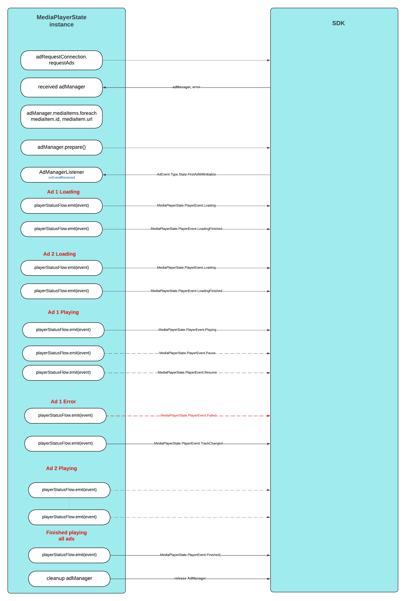

# Client-Side Insertion using MediaPlayerState with your player

## Client-Side insertions using MediaPlayerState interface

Similar with AdPlayer interface, once the manager has been received as an object after requesting ads, it can receive a MediaPlayerState object
like in the following code snippet:

You can retrieve also the media items from the AdManager which can be used to create you player playlist


```kotlin
	data class AdMediaItem(val id: String, val url: Uri)
```

```kotlin
	AdswizzAdRequest.Builder() //Build the Ad Request with the needed parameters
            .withServer("SERVER_PROVIDED_BY_PIM")
            .withZones(setOf(AdswizzAdZone("ZONEID_1_PROVIDED_BY_PIM"), ... AdswizzAdZone("ZONEID_n_PROVIDED_BY_PIM")))
            .build { adswizzAdRequest ->
			
			val adRequestConnection = AdRequestConnection(adRequest) // Create the AdRequestConnection using the above adRequest

			//request ads
			adRequestConnection.requestAds { adManager, error ->
					// Handle the response from server
				if (adManager != null) {
                            //Handle success
                            adManager.adManagerSettings =
                                AdManagerSettings.Builder() // optional
                                    .adMediaPlayerStatsInstance(YOUR_MEDIA_PLAYER_STATE_INSTANCE_GOES_HERE) // optional
                                    .addCachePolicy(CachePolicy.ASSETS)         // optional
                                    .assetQuality(AssetQuality.MEDIUM)          // optional, other possible values AssetQuality.LOW, AssetQuality.HIGH, AssetQuality.AUTO
                                    .enqueueEnabled(false)                      // optional
                                    .videoViewId(1)                             // optional
                                    .timeoutIntervalForResource(10.0)			// optional, used by internal players, defaults to internal exoplayer timeout (8 sec)
                                    .automaticallyManageAudioFocus(true)		// optional, used by internal players, defaults to internal exoplayer audio focus handling
                                    .build()                                    // optional
                            adManager.setListener(this) // Get notifications from the Ad SDK
                            
                            
                            /*
                            	Retrieve ads as MediaItems
                            */
                            adManager.mediaItems.foreach{ item ->
                            	// load item.url with item.id as unique media item id
                            	// and after loading all items prepare the player
                            }
                                                        
                            adManager.prepare() // Start buffering the ads in the AdManager
                        
                            
                            /*
                            	Here you can start your player
                            */
                            //player.play()
                            
                        } else {
                            //Handle failure
                            Log.e("Error", error.toString())
                        }
                    }
			}
			
    }

```


## MediaPlayerState interface

**MediaPlayerState** aims to replace AdPlayer interface providing a simpler interface and some modern kotlin improvements like flows or duration.

```kotlin
interface MediaPlayerState {

	// Playhead position of currently playing item
    val currentPlayhead: Duration

    // The media item total duration.
    val currentDuration: Duration

    // This is the event channel which the player uses to comunicate to sdk
    // player events changes (like buffering, pause, resume, playing, etc.)
    val playerStatusFlow: SharedFlow<PlayerEvent>

    // Reports the volume for the player. This value should be between [0..1].
    // A value of 0.0 indicates silence; a value of 1.0 (the default) indicates full audio volume for the player instance.
    val playerVolume: Float

    // Tells if the player continues buffering after it was paused. Usefull only for 
    // streaming to determint if resuming the stream resumes the ad
    val isBufferingWhilePaused: Boolean get() = true

    // Used for targetability purposes.
    // A list of player capabilities.
    val playerCapabilities: List<PlayerCapabilities>

    // Used for targetability purposes.
    // A list of player states as described by the IAB, which will help achieve better targetability.
    val playerState: List<PlayerState>

	// Object used by Metadata event to encapsulate metadata. Used by streaming only
    data class MetadataItem(val key: String, val value: String)

	//Type of generic errors player should send. They are VAST compliant errors
    sealed class PlayerError(err: Exception){
        data class GeneralError(val error: Exception) : PlayerError(error)
        data class FileNotFound(val error: Exception) : PlayerError(error)
        data class Timeout(val error: Exception) : PlayerError(error)
        data class MediaFileNotSupported(val error: Exception) : PlayerError(error)
        data class MediaFileDisplayError(val error: Exception) : PlayerError(error)
    }

    /**
     * Various player states send as event changes through playerStatusFlow
     */
    sealed class PlayerEvent(open val mediaId: String){
        /*
             This event is sent when player start loading a media item
                url - uri of media item
         */
        data class Loading(override val mediaId: String): PlayerEvent(mediaId)

        /*
          This event is sent when player finished loading a media item
            url - uri of media item
        */
        data class LoadingFinished(override val mediaId: String): PlayerEvent(mediaId)

        /*
          This event is sent when a media item failed to load or failed during playing
            url - uri of media item
        */
        data class Failed(override val  mediaId: String, val error: PlayerError): PlayerEvent(mediaId)


        /*
          This event is sent when a media item has paused due to buffering the content of media item
            url - uri of media item
        */
        data class Buffering(override val mediaId: String): PlayerEvent(mediaId)

        /*
          This event is sent when a media item has resumed after buffering finishes
            url - uri of media item
        */
        data class BufferingFinished(override val mediaId: String): PlayerEvent(mediaId)

        /*
          This event is sent when player start playing
            url - uri of media item currently playing
        */
        data class Playing(override val mediaId: String): PlayerEvent(mediaId)

        /*
          This event is sent when a player paused
            url - uri of media item currently paused
        */
        data class Pause(override val mediaId: String): PlayerEvent(mediaId)

        /*
          This event is sent when a player resumed content
            url - uri of media item currently resumed
        */
        data class Resume(override val mediaId: String): PlayerEvent(mediaId)

        /*
          This event is sent when a player finished playing all media items
            url - uri of last media item in the list
        */
        data class Finished(override val mediaId: String): PlayerEvent(mediaId) //


        /*
          This event is sent when a player received metadata from the stream. Only for Server Side insertion
            url - uri of stream
        */
        data class Metadata(override val mediaId: String, val list: List<AdPlayer.MetadataItem>): PlayerEvent(mediaId)


        /*
            This event is sent when a player advanced to the next item in the list
                 url is the Uri of next media item to be played
        * */
        data class TrackChanged(override val mediaId: String): PlayerEvent(mediaId)


        /*
            This event is sent when a player skipped current item
                     url is the Uri of the item being skipped
           * */
        data class SkipAd(override val mediaId: String, val error: PlayerError? = null): PlayerEvent(mediaId)
    }
}
```


## Events sent by MediaPlayerState implementation. 

Events sent by MediaPlayerState implementation are similar to AdPlayer.Listener function callbacks and should be sent in a specific order.

`Loading` and `LoadingFinished`. This pair of events should be sent foreach `media items` ( `ads` ) when the player starts loading the corresponding items. These events are needed for firing VAST related events

`Buffering` and `BufferingFinished`. This pair of events should be sent every time player is stalling while buffering current content, but only when the player started playing items in the playlist and not before first loading event.
The mediaId should reflect current item playing when buffering occurred. If there is buffering or caching for other media item than the current one, these events should not be triggered and can cause SDK to trigger duplicate vast events.

`Failed` events should be sent any time the player raise an exception no matter where on the playing timeline occurs. They can be triggered in the loading part or when playing and for each item that raise the exception.

`Playing` events should be sent every time the player changes to the playing the current item. 

`Pause` and `Resume`. This pair of events should be sent each time the player is paused and resumed. 

`TrackChanged` need to be sent when player advance to a new media item in the playlist 

`SkipAd` should be sent if the media item is skipped during playing it

`Finish` should be sent when the player finished all media items received from the AdRequest

`Metadata` should be sent when player receives a metadata from the stream. Only needed on Server-Side insertion

**** Note: All paired events: `Loading` and `LoadingFinished`, `Buffering` and `BufferingFinished`, `Pause` and `Resume` should be sent in pairs except when a `Failed` event or `Finish` event is triggered and closing events of the pair
might be missing (LoadingFinished, BufferFinished, Resume)


## Events diagram
Here is a diagram showcasing order of events that should be triggered by MediaPlayerState implementation


