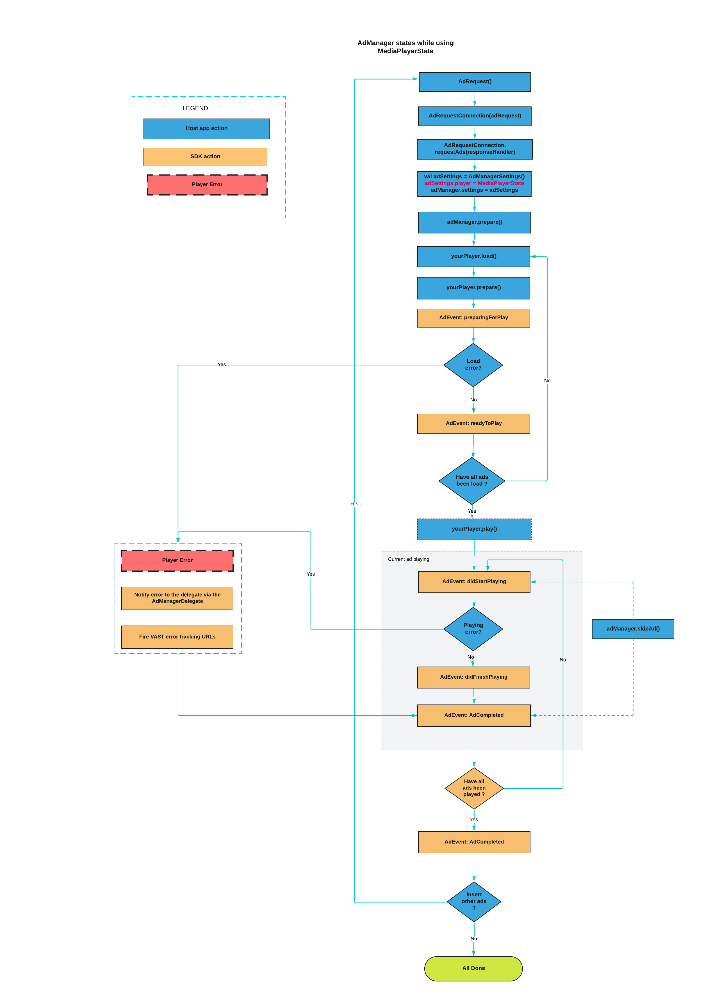

# Playing ads using your player using MediaPlayerState interface [BETA]

As of version 7.9.3, **_AdswizzSDK_** introduces a new event-driven integration method. The `MediaPlayerState` interface now offers a more Kotlin-friendly approach to pass your player events to the `AdManager`.

> **Note**
> 
> The MediaPlayerState approach is currently in beta and may be modified in future releases based on your feedback. 
> For now, MediaPlayerState is available only for Client-Side insertion scenarios without video ad capabilities.


## Client-side setup 

Similar to the `AdPlayer` interface, once you receive the `AdManager` instance through an `AdswizzAdRequest`, you can set your `MediaPlayerState` implementation in the **_AdManagerSettings_** builder as follows:

```kotlin
	AdswizzAdRequest.Builder() //Build the Ad Request with the needed parameters
            .withServer("SERVER_PROVIDED_BY_PIM")
            .withZones(listOf(AdswizzAdZone("ZONEID_1_PROVIDED_BY_PIM"), ... AdswizzAdZone("ZONEID_n_PROVIDED_BY_PIM")))
            .build { adswizzAdRequest ->
			
			val adRequestConnection = AdRequestConnection(adRequest) // Create the AdRequestConnection using the above adRequest

			//request ads
			adRequestConnection.requestAds { adManager, error ->
					// Handle the response from server
				if (adManager != null) {
                            //Handle success
                            adManager.adManagerSettings =
                                AdManagerSettings.Builder() 
                                    .mediaPlayerStateInstance(YOUR_MEDIA_PLAYER_STATE_INSTANCE_GOES_HERE) 
                                    .assetQuality(AssetQuality.MEDIUM)          // optional, other possible values AssetQuality.LOW, AssetQuality.HIGH, AssetQuality.AUTO
                                    .build()                                    // optional
                            adManager.setListener(this) // Get notifications from the Ad SDK
                            
                            
                            /*
                                Here you can iterate the ads array and set them in your player.
                            */
                            adManager.ads.foreach{ adData ->
                                 loadAdInYourPlayer(adData.mediaUrlString)
                            	// load item.url with item.id as unique media item id
                            	// and after loading all items prepare the player
                            }
                                                        
                            adManager.prepare() // The AdManager will start observe the MediaPlayerState events
                        
                            
                            /*
                            	Here you can start your player
                            */
                            //player.play()
                            
                        } else {
                            //Handle failure
                            Log.e("Error", error.toString())
                        }
                    }
			}
			
    }

```


## MediaPlayerState interface

**MediaPlayerState** aims to simplify communication by using `kotlinx.coroutines.SharedFlow` to emit `PlayerEvents` during ad playback.

```kotlin
interface MediaPlayerState {

    /**
     * This represents the current playing position. 
     * This variable reflect the continuous progress for each item that is currently playing.
     */
    val currentPlayhead: Duration

    // This is the event channel which the player uses to communicate to sdk
    // player events changes (like buffering, pause, resume, playing, etc.)
    val playerStatusFlow: SharedFlow<PlayerEvent>

    // Reports the volume for the player. This value should be between [0..1].
    // A value of 0.0 indicates silence; a value of 1.0 (the default) indicates full audio volume for the player instance.
    val playerVolume: Float

    // Used for targetability purposes.
    // A list of player capabilities.
    val playerCapabilities: List<PlayerCapabilities>

    // Used for targetability purposes.
    // A list of player states as described by the IAB, which will help achieve better targetability.
    val playerState: List<PlayerState>

	//Type of generic errors player should send. They are VAST compliant errors
    sealed class PlayerError(err: Exception){
        data class GeneralError(val error: Exception) : PlayerError(error)
        data class FileNotFound(val error: Exception) : PlayerError(error)
        data class Timeout(val error: Exception) : PlayerError(error)
        data class MediaFileNotSupported(val error: Exception) : PlayerError(error)
        data class MediaFileDisplayError(val error: Exception) : PlayerError(error)
    }

    /**
     * Various player states send as event changes through playerStatusFlow
     */
    sealed class PlayerEvent(open val id: String){
        /*
           This event is triggered when the player starts loading the media file (ad creative) for the corresponding ad.
              - here you have to pass an id, that is the instanceId from AdData
        */
        data class Loading(override val id: String): PlayerEvent(id)

        /*
            This event is triggered when the player finishes loading the media file (ad creative) for the corresponding ad.
              - here you have to pass an id, that is the instanceId from AdData
        */
        data class LoadingFinished(override val id: String): PlayerEvent(id)

        /*
           This event is triggered when the media file (ad creative) for the corresponding ad failed to load or failed during playback.
              - here you have to pass an id, that is the instanceId from AdData
        */
        data class Failed(override val  id: String, val error: PlayerError): PlayerEvent(id)


        /*
          This event is triggered when the playback has paused when a buffering state occurred.
          This event should be triggered only for current playing ad creative.
               - here you have to pass an id, that is the instanceId from AdData
        */
        data class Buffering(override val id: String): PlayerEvent(id)

        /*
          This event is triggered when a media item has resumed after buffering finishes.
          This event should be triggered only for current media file (ad creative) during its playing phase
            - here you have to pass an id, that is the instanceId from AdData
        */
        data class BufferingFinished(override val id: String): PlayerEvent(id)

        /*
          This event should be triggered when your player will begin to play the media file (ad creative).
            - here you have to pass an id, that is the instanceId from AdData
        */
        data class StartPlaying(override val id: String): PlayerEvent(id)

        /*
          This event should be triggered when your player paused current the media file (ad creative).
             - here you have to pass an id, that is the instanceId from AdData
        */
        data class Pause(override val id: String): PlayerEvent(id)

        /*
          This event should be triggered when your player resumes the current media file (ad creative).
             - here you have to pass an id, that is the instanceId from AdData
        */
        data class Resume(override val id: String): PlayerEvent(id)

        /*
          This event should be triggered when your player finishes playing the current media file (ad creative).
              - here you have to pass an id, that is the instanceId from AdData
        */
        data class Finished(override val id: String): PlayerEvent(id)

        /*
           This event should be triggered when your player skipped the current media file (ad creative).
              - here you have to pass an id, that is the instanceId from AdData and an Optional PlayerError.
              - error: PlayerError should be passed when the skip action is done due to Playback Exceptions.
        */
        data class SkipAd(override val id: String, val error: PlayerError? = null): PlayerEvent(id)
    }
}
```

## Events Emitted by MediaPlayerState Implementation

The events emitted by the `MediaPlayerState` implementation are similar to `AdPlayer.Listener` function callbacks and should be sent in a specific order.

- `Loading` and `LoadingFinished`

This pair of events should be sent for each ad when the player starts and finishes loading the corresponding item. These events are necessary for triggering VAST-related events.

- `Buffering` and `BufferingFinished`

This pair of events should be sent whenever the player stalls while buffering the current content, but only during the playing phase of the items. `Buffering` and `BufferingFinished` events during the loading phase serve no purpose in the SDK.

The id (adInstanceID) should reflect the current ad playing when buffering occurs. If buffering or caching occurs for ads other than the current one, these events should not be triggered, as they can cause the SDK to trigger duplicate VAST events.

- `Failed`

`Failed` events should be sent any time the player raises an exception, regardless of where it occurs on the playback timeline. They can be triggered during loading or playback and should be sent for each ad that raises an exception.

- `StartPlaying`

`StartPlaying` events should be sent every time the player begins playing the current ad.

- `Finish`

`Finish` should be sent for each ad that was scheduled to play, even if the corresponding creative item failed during loading. This event must be paired with a `StartPlaying` event if the creative item successfully loaded and started playing, or with a `Failed` event if the ad failed during loading.

- `Pause` and `Resume`

This pair of events should be sent each time the player is paused and resumed.

- `SkipAd`

`SkipAd` should be sent if the ad is skipped during playback.

> **Note**  
> 
> All paired events - `Loading` & `LoadingFinished`, `Buffering` & `BufferingFinished`, `Pause` & `Resume` — should be sent in pairs. However, if a `Failed` or `Finish` event is triggered, the closing events of the pair (`LoadingFinished`, `BufferingFinished`, `Resume`) might be missing.

## Events Diagram

Here is a diagram showcasing the order of events that should be triggered by your `MediaPlayerState` implementation:


