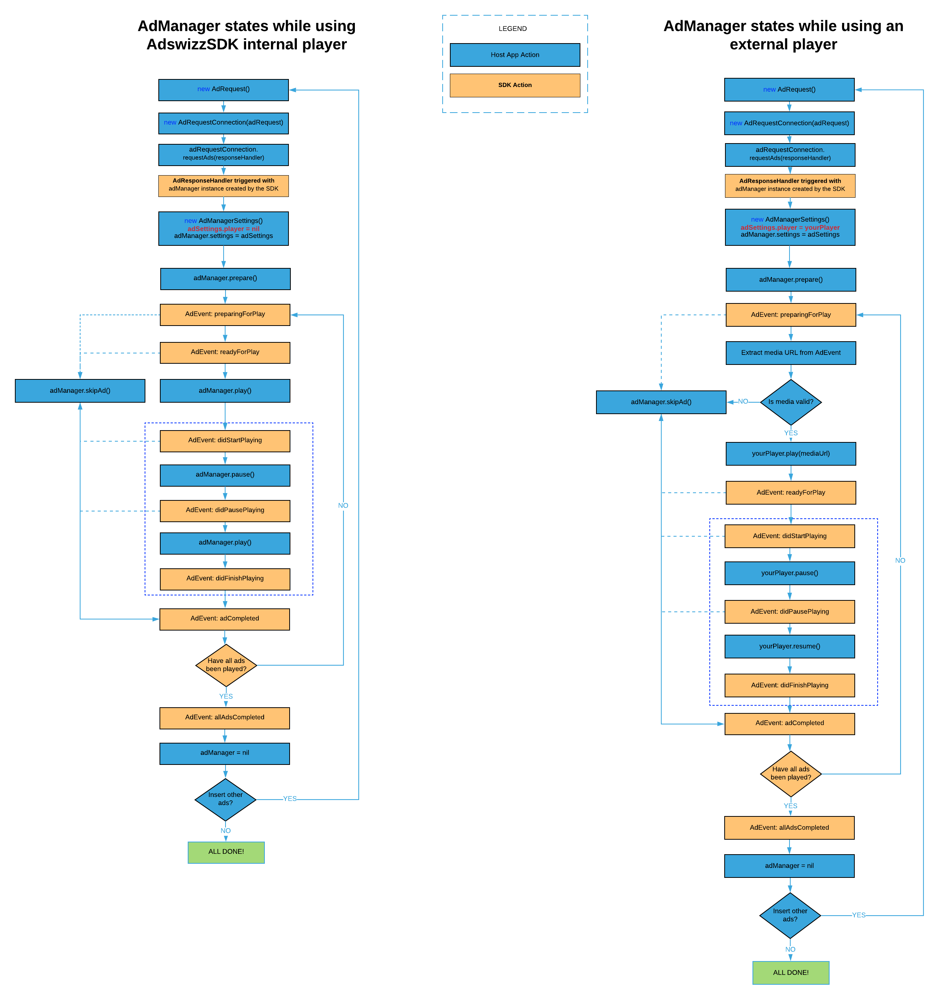

# Client-Side Insertion

## Your first ad request

You are now ready for your first ad request. You will need to create an AdswizzAdRequest object and configure it.

**Minimal request parameters**
The `AdswizzAdRequest` requires at minimum to set server url and a set of one ore more `AdswizzAdZone`.

```kotlin
	data class AdswizzAdZone @JvmOverloads constructor(
        @Json(name = "zoneId")
        val zoneId: String,
        @Json(name = "maxAds")
        val maxAds: Int? = null,
        @Json(name = "maxDuration")
        val maxDuration: Long? = null
)
```
Each `AdswizzAdZone` object is defined by a mandatory zoneId and optionals maxAds and maxDuration fields, where zoneId is provided by PIM and the other fields are defined by the application logic therefore not mandatory.


The minimal request than looks like the following: one or more zones and a server url 
```kotlin
val adRequest: AdswizzAdRequest = AdswizzAdRequest.Builder() //Build the Ad Request with the needed parameters
            .withServer("SERVER_PROVIDED_BY_PIM")
            .withZones(setOf(AdswizzAdZone("ZONEID_1_PROVIDED_BY_PIM"), ... AdswizzAdZone("ZONEID_n_PROVIDED_BY_PIM")))
            .build()
```
The ad server and the zoneId(s) will be provided to you by an AdsWizz PIM.

**Custom request parameters**

You may use custom parameters (key-value pairs) in your requests, in order to send various information, such as the TCF v2 consent string, the publisher-specific ID, first-party targeting data etc.
Here is an example:

```kotlin
	AdswizzAdRequest.Builder()
		.withCustomParameter("key1=URLEncodedValue1&key2=URLEncodedValue2")
		...
```

**Duration request parameters**

An optional parameter is duration which sets the maximum total duration of ads to be selected, in seconds. It can be used to fine tune the ad(s) delivery and request a specific total duration.
Duration parameter is set in milliseconds
Here is an example that sets max duration to 90 seconds

```kotlin
	AdswizzAdRequest.Builder()
		...	
		.withDuration(90000L)
		...
```

**(Advanced) Enable expected ads reporting**

You may enable the reporting on the number of expected ads by setting the `enableExpectedAdsReporting` to `true` in your **_AdswizzAdRequest_** objects. By default `enableExpectedAdsReporting` is `false`.

Here is an example:
```kotlin
    AdswizzAdRequest.Builder()
        ...
        .withExpectedAdsReporting(true)
        ...
```

Read more about this behaviour at [(Advanced) Handling AdManager reporting for expected ads](#advanced-handling-admanager-reporting-for-expected-ads).

**AdRequestConnection**

After this point you need to create an AdRequestConnection object and call requestAds with the ad request object.

```kotlin            
val adRequestConnection = AdRequestConnection(adRequest) // Create the AdRequestConnection using the above adRequest

adRequestConnection.requestAds { adManager, error ->
            // Handle the response from server
            handleResponse(error, adManager)
        }
```
As a result, of this call the SDK will provide you with an error if the call was a failure or an AdManager object if the result was a success.

## Working with AdManager object

If the request to the AdsWizz Ad server was a success, the SDK will return an AdManager object which you will own and will be the way the SDK will communicate events back to your application.
To get this communication channel open, you need to set up a listener for the AdManager that conforms to the AdManagerListener interface. The AdManager will call:

`onEventReceived(adManager: AdManager, event: AdEvent)` whenever events of interest might happen in the SDK. Consult AdEvent.Type for a list of possible events from the AdswizzSDK.

If an error happens in the SDK while using this object, `onEventErrorReceived(adManager: AdManager, ad: AdData?, error: Error)` will be called.

As a first step, an **_AdManager_** needs to have some settings. You can create an **_AdManagerSettings_** object and pass it to your newly created instance of **_AdManager_**. Otherwise the **_AdMnager_** will use the default values.  
In this object you can specify if you want to play the ad with the SDK’s internal player or a player of your choice that must conform to **_AdPlayer_** interface.  
Also you can specify the cache policy (default none), the assets quality preference (default high), the video view id and if the player should play the ads one by one or as a playlist (enqueueEnabled, default true).

Next, you need to call prepare method on the **_AdManager_** object.
This will buffer the ads if you decide to play them with the internal player. Here is how it looks like.

```kotlin
class MainActivity : AppCompatActivity(), AdManagerListener {

    override fun onCreate(savedInstanceState: Bundle?) {
        super.onCreate(savedInstanceState)
        setContentView(R.layout.activity_main)

        val adRequest: AdswizzAdRequest =
            AdswizzAdRequest.Builder() //Build the Ad Request with the needed parameters
                .withServer("SERVER_PROVIDED_BY_PIM")
                .withZones(setOf(AdswizzAdZone("ZONEID_PROVIDED_BY_PIM")))
                .build()

        val adRequestConnection =
            AdRequestConnection(adRequest) // Create the AdRequestConnection using the above adRequest

        adRequestConnection.requestAds { adManager, error ->
            // Handle the response from server
            if (adManager != null) {
                //Handle success
                adManager.adManagerSettings = AdManagerSettings.Builder() // optional
                    .adPlayerInstance(YOUR_AD_PLAYER_GOES_HERE) // optional
                    .addCachePolicy(CachePolicy.ASSETS)         // optional
                    .assetQuality(AssetQuality.MEDIUM)          // optional, other possible values AssetQuality.LOW, AssetQuality.HIGH, AssetQuality.AUTO
                    .enqueueEnabled(false)                      // optional
                    .videoViewId(1)                             // optional
                    .build()                                    // optional
                adManager.setListener(this) // Get notifications from the Ad SDK
                adManager.prepare() // Start buffering the ads in the AdManager
                adManager.play() // Start playing when first add finish loading
            } else {
                //Handle failure
                Log.e("Error", error.toString())
            }
        }
    }

    override fun onEventErrorReceived(adManager: AdManager, ad: AdData?, error: Error) {
    }

    override fun onEventReceived(adManager: AdManager, event: AdEvent) {
        when(event.type) {
            AdEvent.Type.State.ReadyForPlay ->  {
                // An add has finished loading and is ready for play
            }
            AdEvent.Type.State.DidFinishPlaying -> {
                // Current ad has finished playing
            }
            AdEvent.Type.State.AllAdsCompleted -> {
                // All ads from the AdManager have finished
            }

            else  -> {
                //do nothing
                //If you want to handle other events individually you can use the same syntax as above,
                //just specify the event type
            }
        }
    }
}
```
To actually start the **_AdManager_** rolling the ads you must call the play method on the **_AdManager_** as we did in the example above.

## AdManager operations

Once presented with an AdManager, one could call different actions on the AdManager. Let’s break them down.

## AdManager interface
### prepare

You call this method to begin to cycle through the ads in the AdManager. This method ensures that the player is starting to buffer enough data so that ad playing starts smoothly. Upon calling this method the ads start loading. The SDK will trigger **_PreparingForPlay_** event informing your app that buffering has begun for a specific ad. Once buffering is done, **_ReadyForPlay_** event for the ad will be triggered. In case the `adManager` instance has no ad (EmptyAds scenario), a **_ReadyForPlay_** event with `null` instead of an `AdEvent` instance will be triggered.

### play

Call **_play_** when you want to play the ads. This can be done before or after the callback **_ReadyForPlay_** was triggered. The SDK will respond with the callback **_DidStartPlaying_** when the playback begins. If the playing was pause use **_resume_** function instead, to resume playing.


### pause

The **_pause_** method will stop playing the ads in the AdManager. AdManager will trigger a **_DidPausePlaying_** event back to your app for confirmation.


### resume

Call **_resume_** when you want to play the ads after a pause. The SDK will trigger a **_DidResumePlaying_** event back to your app for confirmation.


### skipAd

If you need to skip an ad you can call this method to skip the current ad from the AdManager. Your app will receive
a **_DidSkip_** or **_NotUsed_** event for the current ad and it will start to play the next one. If no ads are available, an **_AllAdsCompleted_** will be sent,
signalling that all ads got processed in the AdManager.

#### skipAd with error

For a more advanced skip handling, you can call **_skipAd(error: Error)_** method to skip the current ad from the AdManager. It follows the same behaviour as for the **_skipAd_** method above. However, by passing an `Error` parameter, the SDK will **not** fire any tracking URLs for `skip` VAST events, but instead it will fire the VAST error tracking URLs. Additionally, for the skipped ad it will also call `fun onEventErrorReceived(adManager: AdManager, ad: AdData?, error: Error)` callback from [AdManagerListener interface](#admanagerlistener-interface) with the same error used in **_skipAd(error: Error)_**.


### reset

If you decide to skip all ads in the AdManager from the current one you can call this method. For the current ad skipped
your app will trigger **_DidSkip_** or **_NotUsed_** and for the rest **_NotUsed_**. A **_AllAdsCompleted_** event will be sent at the end.
Looping through the ad again will need a call to **_prepare_** function.</br>

### ads

Get the normal ads in the ad manager. A zero value means the Ad Manager will not play any ad.

### analyticsCustomData

Set an **_AnalyticsCustomData_** data class to provide key-value custom attributes to all **_AnalyticsEvent_** instances triggered by the AdswizzSDK for Analytics purposes. Read more at [AdswizzSDK Analytics](SDKAndroid/AdswizzSDKAnalytics).


## AdManagerListener interface

Notifications sent from `AdManager` to your app are implemented in the AdManagerListener interface. After listener is set using `setListener(listener: AdBaseManagerListener)` method of the AdManager your app will be called for the following cases

### onEventReceived 

Called when there is an event with the current ad in the ad manager. Some of the events are: Initialized, FirstAdWillInitialize, PreparingForPlay, ReadyForPlay, DidStartPlaying, DidResumePlaying, DidFinishPlaying , Completed and so on. See `AdEvent` for a complete list. 

### onEventErrorReceived

Called when there was an error playing the ad.

## AdBaseManagerAdapter interface

Starting with 7.3.1 the SDK is also able to request data in order for your application to benefit from additional customisation while working with the AdManager object. To be able to customise the behaviour, you need to set up an adapter with `setAdapter` for the AdBaseManagerAdapter that conforms to the `AdBaseManagerAdapter` interface.
Through the `AdBaseManagerAdapter` adapter, when firing VAST tracking URLs, the SDK is currently able to ask for your additional custom tracking URLs which will be fired along using the same engine thus ensuring retryability and other improvements under the hood.
The `AdBaseManagerAdapter` adapter allows your integration to pass your own custom tracking URLs for the following use cases:

```kotlin
fun urlsForTracking(event: Tracking.EventType, adBaseManager: AdBaseManager, adData: AdData): List<String> 
```
Called when the AdManager is about to trigger a VAST event. It passes the Tracking.EventType, for which the SDK could fire your custom additional URLs. Check the Tracking.EventType, enum for possible values.


```kotlin
fun urlsForImpression(adBaseManager: AdBaseManager, adData: AdData): List<String> 
```
Called when the AdManager is about to trigger impressions.


```kotlin
fun urlsForError(errorCode: VASTErrorCode, adBaseManager: AdBaseManager, adData: AdData): List<String> 
```
Called when the AdManager is about to trigger a VAST error. It passes the VastErrorCode for which the SDK could fire your custom additional URLs. Check the VastErrorCode enum for possible values.


```kotlin
fun urlsForCompanionClickTracking(adBaseManager: AdBaseManager, adData: AdData): List<String>
```
Called when the AdManager is about to trigger companion banner click URLs. When a companion banner is tapped, the SDK could fire your custom additional URLs.


```kotlin
fun urlsForVideoClickTracking(adBaseManager: AdBaseManager, adData: AdData): List<String>
```
Called when the AdManager is about to trigger video view click URLs. When the video view is tapped, the SDK could fire your custom additional URLs.


```kotlin
fun urlsForNoAd(adBaseManager: AdBaseManager, noAdUrlString: String): List<String> 
```
Called when the AdManager is about to trigger empty ads event. See  `Handling AdManager with no ads` for more information


## Handling AdManager with no ads

In some cases the **_AdManager_** you'll receive won't have any playable ads. In this case inspecting the `ads` property on the **_AdManager_** will return a zero count. Read more about this property in the above section.
A non playable ad is referred to as being an _empty ad_. The empty ads won't play any media, however your app still needs to instruct the **_AdManager_** to play them by calling the `play()` method.

Nevertheless, here is a simplified setup that highlights handling an **_AdManager_** with no ads:

```kotlin
......

override fun onEventReceived(adManager: AdManager, event: AdEvent) {
    when (event.type) {
         .....
        AdEvent.Type.State.ReadyForPlay -> {
            appLogs.addEntry("Ad ${event.ad?.id} - ready for play")
            
            //Start playing the next ad in the AdManager. 
            //Notice that there is no need to check if the ad is empty or not.
            //The SDK will handle it internally and send the appropriate AdEvent just like for a non empty ad.
            adManager?.play()
            
            //Note: just to be sure that the ad playback will start immediately wait for the <<AdEvent.Type.State.ReadyForPlay>> event before calling adManager?.play()
        }
        .....
        AdEvent.Type.State.AllAdsCompleted -> {
            appLogs.addEntry("Ad - all ads completed")
            
            //All ads from the AdManager have finished.
            //Here you can resume playing your content.
        }
    }
}
......
}
```
Important: failing to call `play()` on an **_AdManager_** with no ads it will prevent AdswizzSDK to correctly track and fire opportunities for reporting purposes.

## (Advanced) Handling AdManager reporting for expected ads

Before requesting ads from the Adswizz server in a [Client-Side Insertion](#client-side-insertion) scenario, on the **_AdswizzAdRequest_** object you can enable **_AdManager_** reporting for the number of expected ads by setting the `enableExpectedAdsReporting` property to `true`. See [Your first ad request](#your-first-ad-request).

When setting the `maxAds` value for an **_AdswizzAdZone_**, the Adswizz server will try to respond with that number of ads.
However, when it cannot fulfill that request, by setting the `enableExpectedAdsReporting` to `true`, the SDK will calculate the difference between number of expected ads (totalMaxAds) and the number of ads from the response and it will determine how many _empty ads_ there are:
```kotlin
numberOfEmptyAds = totalMaxAds - numberOfAdsFromVASTResponse
```

Note that the `totalMaxAds` also takes into account zones which didn't configure a specific `maxAds` in which case every such zone will count as +1 towards the total number of expected ads.

Read more about _empty ads_ at [Handling AdManager with no ads](#handling-admanager-with-no-ads).

The `numberOfEmptyAds` computed above represents the number of _empty_ ads that will be appended to the ads container of the resulting **_AdManager_**.
For each _empty_ **_AdData_** the SDK will fire the `urlsForNoAd(adBaseManager: AdBaseManager, noAdUrlString: String): List<String>`
callback of the `AdBaseManagerAdapter` interface.

Read more about `AdManagerDatasource` methods and behaviour at [Working with AdManager object](#working-with-admanager-object).

**Example**
```kotlin
        ...
        val adRequest: AdswizzAdRequest =
            AdswizzAdRequest.Builder() //Build the Ad Request with the needed parameters
                .withServer("SERVER_PROVIDED_BY_PIM")
                .withExpectedAdsReporting(true)
                .withZones(setOf(AdswizzAdZone(zoneId = "12345", maxAds = 3), AdswizzAdZone(zoneId = "122245", maxAds = 2), AdswizzAdZone(zoneId = "17865")))
                .build()
        ....
```
In the above request the number of ads requested are 3 (zoneId = "12345") + 2 (zoneId = "122245") + 1 (zoneId = "17865") = 6. If no maxAds is provided (like for zone "17865")
or is equal to 0, this actually means that 1 ad is requested. In this example the `numberOfEmptyAds` are `6 - numberOfAdsFromVASTResponse`.


## AdManager life cycle

After requesting your first ad from the Adswizz ad server, you are ready to play the ads from the AdManager object. Keep in mind that you might receive more than one ad from the server, but you are not required to play them all. If you decide to play multiple ads in your app, you need to listen to the events that the AdManager sends to your app and decide what is the appropriate action to take. Here is a diagram of the AdManager state.



